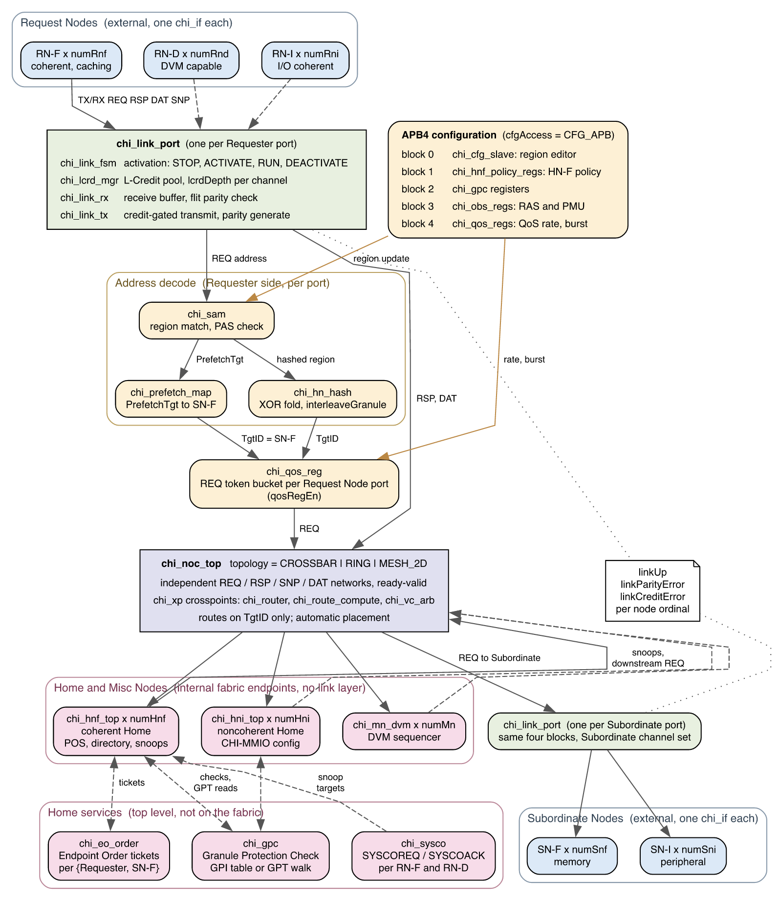

```{=openxml}
<w:p><w:pPr><w:pStyle w:val="TOCHeading"/></w:pPr>
  <w:r><w:t xml:space="preserve">List of Tables</w:t></w:r></w:p>
<w:p><w:r>
  <w:fldChar w:fldCharType="begin" w:dirty="true"/>
  <w:instrText xml:space="preserve">TOC \h \z \t "Table Caption,1"</w:instrText>
  <w:fldChar w:fldCharType="separate"/>
  <w:fldChar w:fldCharType="end"/>
</w:r></w:p>
<w:p><w:pPr><w:pStyle w:val="TOCHeading"/></w:pPr>
  <w:r><w:t xml:space="preserve">List of Figures</w:t></w:r></w:p>
<w:p><w:r>
  <w:fldChar w:fldCharType="begin" w:dirty="true"/>
  <w:instrText xml:space="preserve">TOC \h \z \t "Image Caption,1"</w:instrText>
  <w:fldChar w:fldCharType="separate"/>
  <w:fldChar w:fldCharType="end"/>
</w:r></w:p>
```

# Document status

This document describes the RTL in this repository against Arm IHI 0050H. It
is a reference implementation, not a compliance claim. Every statement about
behaviour below was checked against the source, and the feature matrix in
Section 1.3 states exactly where each function stops.

The document is generated from a single Markdown source in `doc-src/` so that
the Word file in `docs/` and the RTL never drift apart. See Section 12.7 for
the regeneration command.

# 1 Scope, Issue H baseline, and feature status

## 1.1 Baseline and exclusions

The architectural reference is Arm IHI 0050H, *AMBA CHI Architecture
Specification*, Issue H, 17 September 2025:
<https://developer.arm.com/documentation/ihi0050/h/>. Section references
identify relevant Issue H material without reproducing Arm prose or tables.

The project implements an on-chip CHI interconnect among RN-F, RN-D, RN-I,
SN-F, SN-I, HN-F, HN-I and MN functions. The following are outside the
project scope and are not present in any form:

- CHI Chip-to-Chip (IHI 0098), CXS, CCIX, die-to-die framing, C2C containers
  and link services.
- Device Assignment and Coherent Device Assignment protocol behaviour. The
  RME-CDA `StreamID` and `SecSID1` flit fields are carried, but no assignment
  or ownership checking exists.
- GDI.
- An RN-side cache controller. This repository is the interconnect; the RN-F
  line-state model in Section 10 is the contract an RN must meet, not RTL
  that is shipped here.

The Issue H errata have not been assessed against this RTL. An item marked
Implemented below means the named block exists in synthesizable RTL and
performs the described function; it is not an interoperability statement.

## 1.2 Status definitions

**Implemented** --- the function exists in synthesizable RTL and performs the
described protocol behaviour over its stated contract.

**Partial** --- useful logic exists, but protocol cases, integration, or
end-to-end behaviour are incomplete. The boundary column says which.

**Not implemented** --- no semantic implementation exists. An enum value or a
packed flit field by itself is carriage, not implementation.

## 1.3 Feature matrix

| Feature | Issue H reference | Status | Actual RTL boundary |
|------------------------|------------|--------------|--------------------------------------------------|
| REQ/RSP/SNP/DAT records and pack/unpack | B13.9, B13.10 | Implemented | Configurable packed records match the Issue H field lists and slot widths, including every documented field overlay. Opcode-dependent field legality is not policed. |
| Fixed flit slot widths and overlays | B13.9.1--B13.9.4 | Implemented | `TxnID` 12, `ReturnTxnID`/`StashLPID` 12, `NumReq`/`Size` 6, `GroupID` 8, RSP `DBID` 12, DAT `DBID` 16, `DataSource` 8, `CCID` 2, `DataID` 2, `CacheLineID` 6, `PAS` 3 are slot widths independent of the node-side field widths. |
| `PAS[2:0]` replacing `NS`/`NSE` | B2.8.2, B13.10.68 | Implemented | REQ and SNP carry the three-bit Physical Address Space selector and the SAM decodes its non-secure sense. |
| One node-facing interface type | B13 | Implemented | `rtl/if/chi_if.sv` is the only interface declaration in the repository and is a superset used by all five external node-class arrays. |
| Top-level interface count and replicated channels | B13.7 | Not implemented | Elaboration requires `numIfPerNode == 1` and `replChannels == 1`. No top-level replication exists. |
| L-Credit manager, link TX and link RX | B13.11, B14.2 | Implemented | `chi_lcrd_mgr`, `chi_link_tx` and `chi_link_rx` implement finite credit accounting, receive buffering, and the `LCrdReturn` exchange in both directions: the transmitter spends its remaining credits on `LCrdReturn` flits when it deactivates, and the receiver recognises a zero `Opcode`, extinguishes the credit and waits for all of them before it releases `LINKACTIVEACK`. |
| Link layer integrated at every node port | B13.11, B14.2 | Implemented | `chi_link_port` instantiates three receivers and three or four transmitters per port, and `chi_interconnect_top` instantiates one per RN-F, RN-D, RN-I, SN-F and SN-I interface. `*LCRDV` are real credit pulses, not ready echoes. |
| Link activation and deactivation FSM | B14.5--B14.6 | Implemented | `chi_link_fsm` implements STOP, ACTIVATE, RUN and DEACTIVATE with credit-drain conditions, and is instantiated per channel per direction inside every port. |
| System coherency interface | B15 | Partial | `TXSACTIVE` and `RXSACTIVE` follow reset and `SYSCOACK` echoes `SYSCOREQ`. There is no power-domain or coherency-entry sequencing. |
| Flit parity | B9.3 | Implemented | `chi_link_tx` generates per-byte flit parity and `chi_link_rx` checks it. `parityEn` is accepted at the top and a mismatch raises `linkParityError` for that node. |
| Control and credit signal checks | B9.3 | Not implemented | The `*CHK` scalars beside control, valid and credit signals are declared in the interface and driven to zero. Only the flit parity vectors are live. |
| Link error reporting | B9 | Implemented | `linkUp`, `linkParityError` and `linkCreditError` are per-node-ordinal top-level outputs. Credit error covers receive-buffer overflow and L-Credit overflow or underflow. |
| Four physically separated internal channels | B2.1, B13 | Implemented | REQ, RSP, SNP and DAT have separate ready/valid arrays, arbitration and topology storage throughout. |
| Unified crosspoint fabric | B1.2, B3.3 | Implemented | One `chi_xp` (four `chi_router`s) builds every topology; routing uses the NodeID only. Registered two-entry output FIFOs, QoS-age-round-robin arbitration, unroutable flits dropped and flagged. Section 5. |
| Crossbar | B1.2 | Implemented | `numXp` fully connected crosspoints, at most one network hop, `numXp = 1` is the central crossbar. |
| Bidirectional ring | B1.2 | Implemented | `numXp` crosspoints, shortest direction with clockwise tie-break, bubble flow control for deadlock freedom. |
| 2D mesh with deterministic XY routing | B1.2, B3 | Implemented | `meshX * meshY` crosspoints, dimension-ordered XY routing. |
| Automatic placement and NodeID | B3.2 | Implemented | Any population and any `numHnf` on any topology; NodeID `{xpId, devicePort, deviceId}`. Custom `PLACEMENTS` validated. |
| HN-F to SN-F pairing | Project-defined | Implemented | `hnfSnfMap` MODULO or TABLE (`HNF_TO_SNF`). |
| Per-node DCT, DMT, DWT capability and run-time policy | B16.1.3, B16.1.5 | Implemented | `RNF_DCT_CAP`, `SNF_DMT_CAP`, `SNF_DWT_CAP` and the APB HN-F policy block gate eligibility; the direct-transfer paths themselves are described in their own rows. |
| Per-hop L-Credits inside the fabric | B13.11 | Not implemented | Internal topology links use ready/valid with registered crosspoint outputs. CHI L-Credits terminate at the node ports. |
| Requester SAM, HN striping and HN-I SAM | B3.1--B3.3 | Implemented | Ordered region table, security rejection, XOR-fold hash and runtime update ports. The decode result overwrites the incoming `TgtID`, which B3.3.1 permits. All five B3.3.1 cases are distinguished, including the two that bypass the address mapper; see Section 6.1. |
| `PrefetchTgt` routing | B3.3.1, B4.2.6.2 | Implemented | `chi_prefetch_map` maps the address to an SN-F independently of the HN hash, the request bypasses the Home, and both the HN-F and HN-I accept and discard it without a response and without a RetryAck. |
| Coherent read family | B4, B5.1 | Partial | `ReadShared`, `ReadClean`, `ReadNotSharedDirty`, `ReadUnique`, `ReadOnce`, `ReadPreferUnique`, `ReadOnceCleanInvalid` and `ReadOnceMakeInvalid` are classified, snooped when required, forwarded, and completed. Response-state selection is simplified and not every legal state combination is produced. |
| Write family | B5.3 | Partial | Fourteen writes including the stash forms are classified and relayed with `CompDBIDResp` combining. Partial-write byte-enable rules, write cancellation and every combined form are incomplete. |
| CMO and combined write-CMO | B7 | Partial | Opcode classification plus completion and persist tracking. Architectural completion points and the snoop and data side effects of each CMO are incomplete. |
| DCT | B2.5.1.3, B4.8 | Partial | Eligibility, forwarding-snoop generation and `SnpRespFwded` collection exist. The fallback path when the forwarding peer cannot supply data is not implemented. |
| DMT, including `ReadNoSnpSep` | B2.5.1.1--B2.5.1.2 | Implemented | `chi_dmt_ctrl` selects direct memory transfer, the downstream read names the Requester in `ReturnNID` and `ReturnTxnID`, the Subordinate sends `CompData` straight to the Requester, and the Home issues only the response it still owes. |
| DWT | B2.3.2.1, B13.10.24 | Implemented | `chi_dwt_ctrl` sets `DoDWT` on the downstream write, the Subordinate returns `DBIDResp` directly to the Requester, and the Home forwards only the completion. |
| Atomics | B2.3.3, B4.2.5, B5.4 | Implemented | `chi_atomic_alu` implements the `AtomicStore`, `AtomicLoad`, `AtomicSwap` and `AtomicCompare` operations. The Home serializes the operand, reads the initial value, applies the operation, writes it back and returns the original value. Little-endian and big-endian operands are both handled. The datapath is 64 bits, so operands wider than 8 bytes are not supported. |
| Far atomics | B4.2.5 | Partial | Operations are executed at the Home. There is no negotiation that pushes the operation to the Subordinate. |
| DVM and MN | B2.3.7, B8 | Partial | The MN serially unicasts `SnpDVMOp` to configured Requesters and collects responses. The two-part DVM message payload is not decoded, so operation-specific ordering is absent. |
| Sequential coherent snoops | B4.3--B4.4, B4.8 | Partial | The Home walks a precise sharer vector one RN-F at a time and collects responses including forwarded and dirty-data cases. One snoop is outstanding at a time. |
| Cache stashing | B4.9, B7 | Implemented | `chi_stash_ctrl` decodes `WriteUniqueFullStash`, `WriteUniquePtlStash`, `StashOnceShared`, `StashOnceUnique`, `StashOnceSepShared` and `StashOnceSepUnique`, resolves `StashNID`, `StashNIDValid`, `StashLPID` and `StashLPIDValid`, issues the matching stash snoop, honours a `DataPull` in the snoop response by issuing the implied read, and returns `Comp`, `StashDone` or the combined `CompStashDone`. |
| RN cache states and transitions | B4.1, B4.6--B4.8 | Not implemented | Out of project scope. State encodings exist in `chi_pkg` and the required model is documented in Section 10, but there is no RN cache controller here. |
| POS and same-line hazards | B1.5, B2.7, B4.11 | Partial | POS storage, allocation and same-line plus ordered hazard logic exist, but the Home FSM admits one transaction at a time, so configured POS depth does not create concurrency. |
| Inclusive precise snoop filter | B4.4, B4.11 | Partial | Set-associative sharer and owner storage with rotating replacement and sequential back-invalidation. State updates are simplified and are not a complete Issue H directory model. |
| Request Retry, `RetryAck` and `PCrdGrant` | B2.5.5, B2.10 | Implemented | `chi_retry` records the `SrcID`, QoS and credit class behind every `RetryAck`, allocates one of four P-Credit types, and issues `PCrdGrant` naming the recorded Requester with no `TxnID` and no `DBID`. QoS selects which record is granted and age breaks ties. |
| P-Credit return | B2.5.6, B2.10.1 | Implemented | A granted credit leaves the accounting either when a request arrives with `AllowRetry` deasserted or when the Requester returns it with `PCrdReturn`, which the Home accepts and discards. |
| Exclusives | B6 | Partial | Line and requester reservation monitors produce `EXOK`. Request classification and the full set of invalidation and failure rules are simplified. |
| Ordering and `ReadReceipt` | B2.7 | Partial | Ordered requests are globally serialized and a `ReadReceipt` is returned for a request that asks for one. Endpoint order and request order are not distinguished. |
| `DataCheck` and poison carriage | B9, B13.10 | Partial | Optional DAT bits pack and unpack end to end. There is no error-response generation from a data check failure. |
| MultiReq, `NumReq` and `CacheLineID` | B2.8, B13.10 | Not implemented | The fields and the `Size`/`NumReq` slot overlay are carried, but no multi-request expansion or per-line tracking exists. `multiReqEn` is checked metadata. |
| PBHA | B13.10 | Not implemented | The four-bit field and its REQ, SNP and DAT slot overlays are carried. No page-based hardware attribute behaviour exists. |
| MTE tag semantics | B12, B13.10 | Not implemented | `Tag`, `TU` and `TagOp` are carried. There is no allocation-tag storage, matching or tag-operation behaviour. |
| MEC | B10.6, B13.10 | Not implemented | The 16-bit `MECID` and its DAT slot overlay are carried. No MEC access control, translation or consistency checking exists. |
| MPAM | B11.4 | Partial | The 12-bit or 15-bit bus is carried in REQ and SNP. There is no resource partitioning or monitoring. |
| APB configuration | Project-defined | Implemented | Secure-write staged region editor with a quiescent commit. Limitations are in Section 7. |
| CHI MMIO configuration | Project-defined | Partial | The HN-I recognizes a 4 KiB window and simple read and write offsets. Security, validation and quiescent commit are incomplete. |
| SVA | Sections above | Partial | Bound local safety, stability and protocol-field properties with functional covers. There is no full protocol checker and no proof closure. |

: Table 1.1 Feature status against Arm IHI 0050H

# 2 Architecture

## 2.1 Architecture at a glance

{width=100%}

Read the figure top to bottom as the life of a request. A Requester drives a
REQ flit onto its `chi_if`. The `chi_link_port` for that port converts the
CHI link-layer contract, which is credit-based and has no ready signal, into
the ready/valid handshake the fabric uses internally: it will not accept a
flit unless the link is in RUN and an L-Credit is outstanding, and it checks
flit parity on the way in. The address then goes to that port's `chi_sam`,
which finds the matching region, applies the `PAS` check and produces a
`TgtID` — through `chi_hn_hash` for an interleaved coherent region, or
through `chi_prefetch_map` for a `PrefetchTgt` hint, which is routed straight
to an SN-F because no Home resource may be consumed for it. `chi_noc_top`
carries the flit across whichever of the three topologies was elaborated, on
one of four independent networks, every topology built from the same
crosspoint and routed on the `TgtID` alone. A Home Node serializes it, and anything it
must send downstream leaves through a second `chi_link_port` to a Subordinate.

Three properties of this arrangement are worth stating explicitly, because
they are the ones that constrain everything else.

The link layer is per port and symmetric. Every external port gets the same
four blocks, so credit accounting and activation are a property of the port
rather than of the node class. Only the channel set differs: a Requester port
receives REQ, RSP and DAT and transmits RSP, SNP and DAT, while a Subordinate
port receives RSP and DAT and transmits REQ, RSP and DAT.

HN-F, HN-I and MN are internal fabric endpoints, not external `chi_if` ports.
They have no link layer, no L-Credits and no activation handshake, which is
why their ordinals read zero in the `linkUp` output. A request reaches them
over the internal ready/valid fabric only.

The SAM is per Requester port, not central. Each port decodes its own
address, which is what B3.1 describes when it says Requesters must have a
System Address Map. A single `chi_cfg_slave` broadcasts region updates to all
of them so they stay consistent.

The rest of this chapter takes those pieces in the order a request meets
them: the node population and how it is numbered (Section 2.2), the four
channels a node port presents (Section 2.3), the four layers the design is
built from (Section 2.4), the interior of the coherent Home because that is
where nearly all protocol state lives (Section 2.5), the configuration and
status plane that sits beside all of it (Section 2.6), and then the RTL
hierarchy and the handshake rules the whole design obeys (Sections 2.7 and
2.8).

## 2.2 Node classes and the node ordinal space

Eight node classes exist. Five of them are external: they appear as a
`chi_if` port array on `chi_interconnect_top` and are driven by logic outside
this repository. Three are internal: they are protocol endpoints built inside
the fabric, reached over the internal networks, and have no pins.

| Node class | Count field | External port | Ordinals | Role in this design |
|--------------|--------------|-------------|----------|-------------------------------------|
| RN-F | `numRnf` | `rnf[]` | 0--3 | Fully coherent Requester. Issues the coherent read, write and CMO families, receives snoops, and is the only class the snoop filter tracks. |
| RN-D | `numRnd` | `rnd[]` | none | Requester that is DVM capable but has no coherent cache. Receives `SnpDVMOp` from the MN, and no other snoop. |
| RN-I | `numRni` | `rni[]` | 4 | I/O coherent Requester. Issues the `ReadOnce` and `WriteUnique` families, and is never snooped. |
| SN-F | `numSnf` | `snf[]` | 5--6 | Subordinate for coherent memory. Terminates the downstream reads and writes a Home issues, and is the target of `PrefetchTgt`. |
| SN-I | `numSni` | `sni[]` | 7 | Subordinate for peripheral space. Same channel set as SN-F; the distinction is which SAM region kind selects it. |
| HN-F | `numHnf` | internal | 8--11 | Coherent Home. Serialization point, snoop filter, POS, retry credits and the offload engines. Section 2.5 and Section 9. |
| HN-I | `numHni` | internal | 12 | Non-coherent Home. Relays to SN-I through its own SAM and hosts the CHI MMIO configuration window. |
| MN | `numMn` | internal | 13 | Misc Node. Sequences DVM operations to the DVM-capable Requesters. |

: Table 2.1 Node classes, their count fields, and their ordinals in the default configuration

All eight classes share one flat ordinal space. The ordinal of a node is its
index into the concatenation RN-F, RN-D, RN-I, SN-F, SN-I, HN-F, HN-I, MN, in
that order, which is what `OFF_RNF` through `OFF_MN` compute in
`chi_interconnect_top`. That single numbering is used for three different
things, and they are worth separating:

- It indexes the internal networks. Every channel array inside the fabric is
  `[NUM_NODES-1:0]`, so an ordinal is also a transport port number.
- It indexes `NODE_IDS`, the parameter that gives each node its CHI `NodeID`.
  Nothing in the protocol requires the two numbering schemes to agree, and
  B3.2 makes NodeID assignment implementation defined, so the ordinal is a
  fabric-internal name and the NodeID is the protocol-visible one.
- It indexes `linkUp`, `linkParityError` and `linkCreditError`. Since the
  three internal classes have no link, the top six bits of those vectors in
  the default configuration are constantly zero, and the smoke run in
  Section 12.7 asserts exactly that.

The default configuration is 4 RN-F, 1 RN-I, 2 SN-F, 1 SN-I, 4 HN-F, 1 HN-I
and 1 MN: fourteen nodes, of which eight have external links.

## 2.3 The four channels

CHI defines four channels, and this design keeps them physically separate
from the node pins all the way to the protocol endpoints: separate valid,
separate ready, separate flit storage, separate arbitration and separate
credit accounting. Nothing is time-multiplexed onto a shared bus anywhere in
the fabric.

| Channel | At a Requester port | At a Subordinate port | What it carries | Default flit width |
|-------|-----------|-----------|--------------------------------|------|
| REQ | node to interconnect | interconnect to node | Requests: opcode, address, `Size`, `TxnID`, `SrcID`, `TgtID`, `PAS`, QoS, and the stash, DVM and atomic qualifiers. | 153 |
| RSP | both directions | both directions | Responses without data: completions, `DBIDResp`, `RetryAck`, `PCrdGrant`, `ReadReceipt`, snoop responses. | 79 |
| SNP | interconnect to node only | not present | Snoops, including the forwarding and stash forms and `SnpDVMOp`. A Subordinate is never snooped. | 106 |
| DAT | both directions | both directions | Data, with `BE`, `DataID`, `CCID`, and the optional `DataCheck`, `Poison` and `RSVDC` fields. | 437 |

: Table 2.2 The four channels, their direction at each port type and their default flit widths

The widths are the derived values for the default configuration and come from
the width functions in `chi_pkg`; Section 3.2.1 gives the formula and the cost
of each parameter that feeds it.

The separation is not cosmetic. A response must be able to make progress
while a request is blocked, or the protocol deadlocks: a Home that cannot
issue `Comp` because the REQ network ahead of it is full, on a REQ network
that cannot drain because the Requester is waiting for that `Comp`, is a
cycle with no escape. Four independent networks break that cycle
structurally, which is why the transport layer in Section 2.4.3 replicates
its whole datapath four times rather than sharing one wider one. The same
reasoning applies one level down at the link layer, where each channel has
its own L-Credit pool of `lcrdDepth` entries and its own activation FSM, so
one starved channel cannot stall another.

SNP asymmetry is the one place where the port types differ in channel count.
A Requester port has six channel instances, a Subordinate port five.
Section 4.1 explains why both still use the same `chi_if` type.

One property of the DAT channel is worth stating here because every consumer
of data in the design depends on it. A data message is not one flit. B2.4.6
makes `DataID` a count of 16-byte granules within the 64-byte line, so a
message of `Size` bytes occupies as many packets as the data bus needs to
carry them: one packet on a 512-bit bus, two on the default 256-bit bus, four
on a 128-bit bus. `NumDat` is unrelated to that count. It belongs to Limited
Data Elision (B2.9.5) and says how many packets behind this one have been
elided. Recognising the end of a message therefore needs the transaction as
well as the packet, which is what `datLastPacket` in `chi_pkg` takes: the
`DataID` and `NumDat` of the packet in hand, plus the address and `Size` of
the request it answers.

## 2.4 The four layers

Every block in the design belongs to one of four layers. The layer boundaries
are also the points at which the representation of a transaction changes,
which is the useful way to read the hierarchy.

| Layer | Modules | Instances | State it owns |
|----------|-----------------------------|------------------|---------------------------|
| Link | `chi_link_port`, `chi_link_rx`, `chi_link_tx`, `chi_lcrd_mgr`, `chi_link_fsm` | 8 ports | L-Credit pools, receive buffers, activation state, parity |
| Address decode | `chi_sam`, `chi_hn_hash`, `chi_prefetch_map` | 5 Requester-side, 1 in the HN-I | Region table, hash configuration |
| Transport | `chi_noc_top`, `chi_xp` under `chi_mesh`, `chi_ring` or `chi_xbar` | 1, four networks wide | Crosspoint output FIFOs, arbiter age and round-robin state |
| Protocol | `chi_hnf_top`, `chi_hni_top`, `chi_mn_dvm` | 4, 1, 1 | POS, snoop filter, retry records, exclusive monitors, transaction FSM state |

: Table 2.3 The four layers, their modules, their instance counts in the default configuration, and the state each owns

### 2.4.1 Link layer

The link layer is the only part of the design that touches CHI pins, and its
job is to convert between two handshakes that do not resemble each other.

On the CHI side a transmitter may send a flit only if it holds an L-Credit
that the receiver previously granted on `*LCRDV`, and there is no ready
signal to push back with. On the fabric side everything is ready/valid. So
each `chi_link_port` contains, per channel and per direction, one activation
FSM (`chi_link_fsm`, with STOP, ACTIVATE, RUN and DEACTIVATE states) plus
either a receiver or a transmitter:

- `chi_link_rx` buffers an incoming flit, checks its parity, and returns an
  L-Credit on `*LCRDV` when the buffer slot frees. The credit it returns is
  the node's permission to send the next flit, so the depth of that buffer
  and the credit pool are the same number, `lcrdDepth`.
- `chi_link_tx` holds the credit pool for its direction in `chi_lcrd_mgr`,
  generates per-byte flit parity, and will not assert `*FLITV` unless the
  link is in RUN and a credit is available. It also detects pool overflow and
  underflow, which is what raises `linkCreditError`.

Credits are borrowed, not given, and that is what makes deactivation more than
a handshake. B14.6.3.2 requires a link to stay in DEACTIVATE until every
credit has come back, and B13.11 gives the transmitter the means to send them
back: `LCrdReturn`, a flit whose `Opcode` is zero and whose other fields are
unused. So `chi_link_tx` spends its remaining credits on `LCrdReturn` flits
once it enters DEACTIVATE and only then drops `LINKACTIVEREQ`, while
`chi_link_rx` recognises a zero `Opcode`, extinguishes the credit rather than
replacing it, and keeps `LINKACTIVEACK` asserted until its count of credits
held by the peer reaches zero. A receiver also has to keep accepting flits in
DEACTIVATE, both for these returns and for a protocol flit that raced the
deassertion of `LINKACTIVEREQ`. Because the `Opcode` field sits at a different
offset in each channel's flit, each `chi_link_rx` instance is given a mask of
that field, derived in `chi_pkg` from the matching pack function so it cannot
drift away from the layout.

Two consequences of this structure show up elsewhere in the document. First,
because the credit pool is per channel per direction, `lcrdDepth` multiplies
by roughly the number of channels times the number of ports when you size
it; Section 3.2.3 does that arithmetic. Second, because activation is per
channel, a link is "up" only when every channel in both directions has
reached RUN, which is the condition `linkUp` reports and the condition the
smoke run in Section 12.7 waits for.

### 2.4.2 Address decode

A REQ flit arrives carrying an address and no target. Something has to turn
that address into a `TgtID` before the transport layer can route it, and
B3.1 puts that duty on the Requester side: every Requester must have a
System Address Map. This design follows that literally, so each of the five
Requester ports has its own `chi_sam` instance rather than sharing a central
decoder.

`chi_sam` walks an ordered region table, takes the first matching region,
and applies the region's security rule against the incoming `PAS`. What
happens next depends on the region kind:

- A plain region names one target directly.
- An interleaved coherent region hands the address to `chi_hn_hash`, which
  folds address bits above `hnHashShift` with XOR and selects one of the
  HN-F instances, so that consecutive `interleaveGranule` blocks land on
  different Homes.
- A `PrefetchTgt` request goes to `chi_prefetch_map` instead, which maps the
  address straight to an SN-F. The Home is bypassed entirely, because a
  prefetch hint must not be allowed to consume a Home resource that a real
  transaction needs.

The HN-I carries a sixth `chi_sam` instance, used for the second decode from
the Home to an SN-I. Section 6 covers the region table and a worked hash
example.

### 2.4.3 Transport

`chi_noc_top` is the transport layer and presents the same interface
regardless of which topology was elaborated: `NUM_NODES` ingress ports and
`NUM_NODES` egress ports, on each of four independent networks, all
ready/valid. Behind that interface every topology is built from one
parameterized crosspoint, `chi_xp`, and every node attaches to a crosspoint
device port:

- `MESH_2D` is a `meshX` by `meshY` grid of crosspoints routed in XY order.
- `RING` is `numXp` crosspoints with a clockwise and a counter-clockwise
  ring, routed the shorter way and kept deadlock free by bubble flow control.
- `CROSSBAR` is `numXp` fully connected crosspoints, so every route is at most
  one network hop; `numXp = 1` is a single central crossbar.

The crosspoints route on the NodeID alone and never look at the address. Each
crosspoint output ends in a two-entry FIFO, so the fabric is registered at
every crosspoint and no ready depends combinationally on a ready further
downstream. None of the topologies carries CHI L-Credits internally: credits
terminate at the node ports. Section 5 gives the routing, NodeID layout,
placement, latency and deadlock arguments.

### 2.4.4 Protocol endpoints

The protocol layer is where a transaction stops being a flit in transit and
becomes state. There are three endpoint types:

- `chi_hnf_top`, the coherent Home, is the serialization point for a line.
  It owns the snoop filter, the POS, the retry records and every engine that
  acts on a coherent transaction. Section 2.5 shows its interior.
- `chi_hni_top`, the non-coherent Home, has no coherence state at all. It
  decodes the address a second time through its own `chi_sam`, relays the
  transaction to an SN-I, and recognises the CHI MMIO configuration window
  described in Section 7.2. It also accepts and discards `PrefetchTgt`
  without responding, for the same reason the HN-F does.
- `chi_mn_dvm`, the Misc Node, is the DVM sequencer. It unicasts `SnpDVMOp`
  to each DVM-capable Requester in turn and collects the responses before
  completing the operation.

## 2.5 Home Node internal architecture

{width=100%}

The coherent Home is where nearly all protocol state lives, so it is shown
separately. A request is either admitted into `chi_pos` or handed to
`chi_retry`, which is the only path that can answer with `RetryAck` and later
`PCrdGrant`. An admitted request is checked by `chi_hazard` against every
other active POS entry for a same-line or ordering conflict before the FSM
acts on it. One globally serial FSM of 22 states then drives whichever engine
the opcode selects: the directory and snoop generator for coherence, the DMT,
DWT and stash controllers when the transaction can be offloaded so that data
bypasses the Home, and the atomic, cache-maintenance and exclusive-monitor
blocks for operations the Home performs itself.

The three offload engines are worth separating from the rest, because they
exist to keep data out of the Home rather than to add behaviour to it.
`chi_dmt_ctrl` names the Requester in `ReturnNID` and `ReturnTxnID` on the
downstream read so the Subordinate sends `CompData` straight back to the
Requester. `chi_dwt_ctrl` sets `DoDWT` on the downstream write so the
Subordinate returns `DBIDResp` directly to the Requester. `chi_dct_ctrl`
turns a snoop into a forwarding snoop so a peer cache supplies the data. In
all three cases the Home still issues the response it alone owes, and the
data never crosses it. Sections 8.1 to 8.3 trace one example of each.

The single-FSM structure is the dominant simplification in this design. The
POS holds `posEntries` entries and detects hazards across all of them, but
only one transaction advances at a time, so POS depth currently buys hazard
visibility rather than throughput. Section 9.1 covers the consequences.

## 2.6 Configuration and status plane

Beside the datapath there is a narrow plane that configures it and reports on
it, and it is deliberately kept out of the transaction path.

Configuration enters through one `chi_cfg_slave`, selected by
`cfgAccess == CFG_APB`, which presents the APB4 register map in Section 7.1.
It stages an edited region into shadow registers and commits it to every
`chi_sam` at once when the fabric is quiescent, so no Requester can decode
half of an old map and half of a new one. When `cfgAccess` is
`CFG_PARAM_ONLY` the block is not built and the region table is whatever the
`REGION_*` parameters set at elaboration; the APB pins are then tied off and
a transfer attempted on them raises `PSLVERR`.

Status leaves through the three per-ordinal vectors already described:
`linkUp`, `linkParityError` and `linkCreditError`. They are the only
observability the design exports, and they are all link-layer facts. There is
no transaction counter, no error-cause register and no interrupt.

## 2.7 RTL hierarchy

```
chi_interconnect_top
├── chi_cfg_check                            (elaboration assertions)
├── rnf_ports[*] / rnd_ports[*] / rni_ports[*] : chi_link_port
│   ├── chi_link_rx  x3   (REQ, RSP, DAT from the node)
│   │   └── chi_link_fsm      (receive direction activation)
│   └── chi_link_tx  x3   (RSP, SNP, DAT to the node)
│       ├── chi_lcrd_mgr      (credit pool, lcrdDepth deep)
│       └── chi_link_fsm      (transmit direction activation)
├── snf_ports[*] / sni_ports[*] : chi_link_port
│   ├── chi_link_rx  x2   (RSP, DAT from the node)
│   └── chi_link_tx  x3   (REQ, RSP, DAT to the node)
├── requester_sam[*]
│   ├── chi_sam  ── chi_hn_hash
│   └── chi_prefetch_map
├── apb_cfg : chi_cfg_slave                          [CFG_APB]
├── hnf_nodes[*] : chi_hnf_top
│   ├── chi_pos
│   ├── chi_hazard
│   ├── chi_snoop_filter
│   ├── chi_snp_gen
│   ├── chi_retry
│   ├── chi_dct_ctrl
│   ├── chi_dmt_ctrl
│   ├── chi_dwt_ctrl
│   ├── chi_stash_ctrl
│   ├── chi_atomic_alu
│   ├── chi_cmo
│   └── chi_excl_mon
├── hni_nodes[*] : chi_hni_top
│   └── chi_sam
├── mn_nodes[*] : chi_mn_dvm
├── apb_cfg/policy_regs : chi_hnf_policy_regs     [CFG_APB]
└── chi_noc_top
    └── chi_mesh | chi_ring | chi_xbar              [topology]
        └── chi_xp[*]
            └── chi_router[REQ/RSP/SNP/DAT]
                ├── chi_route_compute[*]
                └── chi_vc_arb[*]
```

Every link block is inside the product hierarchy; none of them is
harness-only. The figures above are generated from Graphviz sources in
`doc-src/figures/`, which `make doc` rebuilds.

## 2.8 Handshake discipline

Every ready/valid channel in the design obeys two rules, and the RTL is
structured so that a linter can see both:

1. A valid and its flit never depend combinationally on the ready they are
   paired with. The Home Node decides a `RetryAck`, a `PCrdGrant` and every
   transaction response without looking at `rspOutReady`.
2. A module that drives both directions of a handshake writes the forward and
   the backward direction in separate `always_comb` blocks. `chi_mesh` uses
   four blocks --- ingress forward, egress forward, egress ready, ingress
   ready --- because a single block would make every crosspoint ready appear
   to depend on every crosspoint valid.

The consequence is that the whole fabric elaborates with no circular
combinational logic, which Section 12.6 records as a passing lint result.

# 3 Parameters and elaboration constraints

## 3.1 `chi_cfg_t`

All count fields are unsigned. "No explicit maximum" means the elaboration
checker has no direct bound; array size, NodeID capacity and tool resources
still apply. This table states what each field does; Section 3.2 states why
it is a parameter at all and what choosing it wrong costs.

| Field | Default | Accepted by `chi_cfg_check` | Effect |
|----------------|---------|----------------------|-----------------------------------------------------|
| `numRnf` | 4 | 0 or greater | External RN-F interfaces and Home sharer-vector width. |
| `numRnd` | 0 | 0 or greater | External RN-D interfaces. |
| `numRni` | 1 | 0 or greater | External RN-I interfaces. |
| `numSnf` | 2 | required when `numHnf>0` | External SN-F interfaces and `PrefetchTgt` targets. |
| `numSni` | 1 | required when `numHni>0` | External SN-I interfaces. |
| `numHnf` | 4 | 0 or greater | Internal HN-F endpoints and hash targets. |
| `numHni` | 1 | 0 or greater | Internal HN-I endpoints. |
| `numMn` | 1 | 0 or greater | Internal MN endpoints. |
| `dataW` | 256 | 128, 256 or 512 | DAT data and derived BE, tag, TU and check widths. |
| `addrW` | 48 | 44 through 52 | REQ address and line and tag widths. |
| `nodeIdW` | 11 | 7 through 16, and at least the routing fields | Active NodeID bits. `chi_cfg_check` reports the minimum for the topology. Internal buses are always 16 bits wide. |
| `txnIdW` | 12 | 8 through 12 | Node-side TxnID width. The flit slot is always 12 bits. |
| `lpidW` | 5 | 1 through 5 | LPID and `StashLPID` overlay width. |
| `rsvdcW` | 0 | 0, 4, 8, 12, 16, 24 or 32 | REQ and DAT RSVDC width. |
| `ccidW` | 2 | 1 or 2 | Node-side CCID width. The flit slot is 2 bits. |
| `groupIdW` | 8 | 1 through 8 | Group-ID overlay width within the 8-bit slot. |
| `mpamW` | 0 | 0, 12 or 15; must be non-zero when `mpamEn` | MPAM bus width. |
| `numIfPerNode` | 1 | exactly 1 | Metadata only; multiple interfaces are rejected. |
| `replChannels` | 1 | exactly 1 | Metadata only; channel replication is rejected. |
| `topology` | `MESH_2D` | `CROSSBAR`, `RING`, `MESH_2D` | Selects the wiring of the crosspoints. |
| `meshX`, `meshY` | 3, 3 | positive for mesh | Mesh crosspoint grid and the X and Y NodeID fields. |
| `numXp` | 4 | RING: at least 2; CROSSBAR: at most `XBAR_MAX_XP` | Crosspoint count of a ring or crossbar and the xpId NodeID field. |
| `numDevPortsPerXp` | 2 | positive; `crosspoints * numDevPortsPerXp >= NUM_NODES` | Device ports per crosspoint for every topology, and the devicePort NodeID field. |
| `snpFilterEntries` | 1024 | positive, divisible by ways | Total Home directory entries. |
| `snpFilterWays` | 4 | 1 through entries, exact divisor | Directory associativity. |
| `posEntries` | 32 | positive | POS array depth. The Home is still globally serial. |
| `retryRecords` | 16 | positive | Retry record table depth, that is, the number of outstanding `RetryAck` records the Home can hold. |
| `lcrdDepth` | 8 | 2 or greater | L-Credits advertised per channel and receive-buffer depth. |
| `exclMonitors` | 32 | positive | Exclusive monitor entries. |
| `interleaveGranule` | 64 | power of two, at least 64 | HN hash stripe bytes. |
| `hnHashShift` | 6 | no range check | XOR fold distance. A shift at or above `addrW` collapses the folded term to zero. |
| `dataCheckEn` | 1 | 0 or 1 | Adds `dataW/8` DAT DataCheck bits. |
| `poisonEn` | 1 | 0 or 1 | Adds `dataW/64` DAT poison bits. |
| `parityEn` | 0 | 0 or 1 | Enables flit parity generation and checking in every link. |
| `mpamEn` | 0 | 0 or 1 | Adds the MPAM bus to REQ and SNP. |
| `mteEn` | 0 | 0 or 1 | Affects DCT eligibility only. MTE semantics are absent. |
| `mecEn` | 0 | 0 or 1; mutually exclusive with `cdaEn` | Adds the 16-bit MECID to REQ, SNP and DAT. |
| `pbhaEn` | 0 | 0 or 1 | Adds the 4-bit PBHA field to REQ. |
| `cdaEn` | 0 | 0 or 1; mutually exclusive with `mecEn` | Adds `StreamID` and `SecSID1` to REQ. |
| `multiReqEn` | 0 | 0 or 1 | Checked metadata. No multi-request behaviour. |
| `dctEn` | 1 | if 1, RN-F and HN-F must exist | Enables DCT eligibility and forwarding snoops. |
| `dmtEn` | 1 | if 1, a Home and SN-F must exist | Enables direct memory transfer. |
| `dwtEn` | 1 | if 1, a Home and SN-F must exist | Enables direct write transfer. |
| `atomicEn` | 1 | if 1, a Home must exist | Enables the atomic transaction path. |
| `dvmEn` | 1 | if 1, an MN and a Requester must exist | Enables the MN sequencer. |
| `stashEn` | 1 | if 1, RN-F and HN-F must exist | Enables stash decode, stash snoops and Data Pull. |
| `exclEn` | 1 | if 1, a Home and monitors must exist | Enables exclusive monitors. |
| `cfgAccess` | `CFG_PARAM_ONLY` | enum; CHI MMIO also requires HN-I | Selects no runtime writes, APB, or CHI MMIO. |
| `hnfSnfMap` | `HNF_SNF_MAP_MODULO` | MODULO or TABLE; TABLE entries must name existing SN-Fs | HN-F to SN-F pairing, and the SN-F anchor of automatic placement. |

: Table 3.1 `chi_cfg_t` fields, defaults and elaboration bounds

Because MECID and StreamID share one REQ field of width `Max(E,R)`, only one
of MEC and RME-CDA can be carried on a given interface. Elaboration rejects
both being enabled.

Derived packed widths at the default configuration are REQ 153, RSP 79,
SNP 106 and DAT 437 bits. The formulas are `reqFlitWidth`, `rspFlitWidth`,
`snpFlitWidth` and `datFlitWidth` in `chi_pkg`, and
`rtl/top/chi_stage1_compile.sv` checks each one against an independent sum of the
field list so that a field added to a record cannot silently bypass the width
helper.

## 3.2 Why the design is configurable

Configuration here answers two different questions, and it matters a great
deal which one a given parameter answers.

Some parameters exist because **CHI itself declares them configurable and
both ends of a link must agree**. Getting one of those wrong is an
interoperability failure, and no amount of verification inside the
interconnect will find it, because the mismatch is at the boundary.

The rest exist because **CHI is deliberately silent about
microarchitecture**. Those are area, power and performance trade-offs.
Getting one wrong costs throughput or area, not correctness.

A third, smaller group is accepted by the elaboration checker but carries no
behaviour yet. Those are listed separately at the end so they are not
mistaken for working features.

### 3.2.1 Parameters fixed by a declared CHI property

CHI Chapter **B16.1, Interface properties and parameters**, defines the
properties an implementation declares for an interface. Every one of them
must match at both ends, because flit length and field position are derived
from them. There is no negotiation on the wire and no self-describing header,
so a mismatch is not an error that gets reported — it is a silent misparse of
every flit on that channel, and the symptom appears as corrupted addresses or
impossible opcodes far from the cause.

| `chi_cfg_t` field | Declared CHI property | What a mismatch between the two ends produces |
|--------------------|----------------------|----------------------------------------------------------|
| `dataW` | B16.1.13 `Data_Width` | Every DAT flit is the wrong length; data, byte enables and check bits all shift. |
| `addrW` | B16.1.11 `Req_Addr_Width` | REQ and SNP lengths differ; addresses decode to the wrong region and the SAM targets the wrong node. |
| `nodeIdW` | B16.1.12 `NodeID_Width` | `TgtID` and `SrcID` misalign on all four channels; responses return to the wrong Requester. |
| `rsvdcW` | B16.1.28 `Req_RSVDC_Width`, B16.1.29 `Dat_RSVDC_Width` | REQ and DAT lengths differ. The field itself is user-defined, but its width is not. |
| `mpamEn`, `mpamW` | B16.1.9 `MPAM_Support` | REQ and SNP lengths differ. A receiver that does not expect MPAM misreads every field above it. |
| `dataCheckEn` | B16.1.6 `Data_Check` | DAT length differs, and end-to-end data integrity is silently unprotected. |
| `poisonEn` | B16.1.4 `Data_Poison` | DAT length differs, and a poisoned line is delivered as valid data. |
| `parityEn` | B16.1.7 `Check_Type` | Check signals are driven but ignored, or expected and undriven. |
| `atomicEn` | B16.1.1 `Atomic_Transactions` | A Requester issues an atomic opcode the Home cannot decode. |
| `stashEn` | B16.1.2 `Cache_Stash_Transactions` | Stash requests and stash snoops are not understood. |
| `dmtEn` | B16.1.3 `Direct_Memory_Transfer` | The Subordinate does not know it must respond directly to the Requester. |
| `dctEn` | B16.1.5 `Direct_Cache_Transfer` | A peer receives a forwarding snoop it cannot service. |
| `dvmEn` | B16.1.22 `DVM_Support` | DVM operations are issued to a node that cannot complete them. |
| `mteEn` | B16.1.23 `MTE_Support` | Memory tagging fields are misinterpreted. |
| `mecEn` | B16.1.25 `MEC_Support`, B16.1.26 `MECID_Width` | REQ, SNP and DAT lengths differ, and realm isolation is lost. |
| `cdaEn` | B16.1.16 `RME_Support` | `StreamID` and `SecSID1` are absent or misplaced in REQ. |
| `pbhaEn` | B16.1.19 `PBHA_Support` | REQ length differs. |
| `multiReqEn` | B16.1.39 `MultiReq_Support` | A multi-request transaction is treated as a single request. |
| `retryRecords` | B16.1.38 `Retry_Support`, with B16.1.34 `Num_RP_REQ` and B16.1.35 `Shared_Credits_REQ` | The P-Credit pool the Requester believes exists does not match what the Home can track. |

: Table 3.2 Configuration fields fixed by a declared CHI interface property

`dwtEn` has no row, and the reason is instructive. There is no declared
property for Direct Write Transfer. It is requested per transaction through
the `DoDWT` field of the REQ flit (B13.10.24), so a Home that does not
implement it simply never sets the bit and no agreement is needed in advance.
That is exactly why `dmtEn` mirrors a B16.1 property while `dwtEn` is a
purely local choice.

Because these properties set flit length, each one has a measurable price.
The following are exact deltas against the default configuration, whose
packed widths are REQ 153, RSP 79, SNP 106 and DAT 437 bits:

| Change from the default | REQ | RSP | SNP | DAT | Total |
|---------------------------------------------|-----------|-----------|-----------|-----------|-----------|
| `nodeIdW` 11 to 16 | +15 | +10 | +10 | +15 | +50 |
| `nodeIdW` 11 to 7 | -12 | -8 | -8 | -12 | -40 |
| `addrW` 48 to 52 | +4 | 0 | +4 | 0 | +8 |
| `dataW` 256 to 512 | 0 | 0 | 0 | +334 | +334 |
| `dataW` 256 to 128 | 0 | 0 | 0 | -167 | -167 |
| `rsvdcW` 0 to 32 | +32 | 0 | 0 | +32 | +64 |
| `mpamEn` with `mpamW` 12 | +12 | 0 | +12 | 0 | +24 |
| `mpamEn` with `mpamW` 15 | +15 | 0 | +15 | 0 | +30 |
| `mecEn` | +16 | 0 | +16 | +16 | +48 |
| `cdaEn` | +17 | 0 | 0 | 0 | +17 |
| `pbhaEn` | +4 | 0 | 0 | 0 | +4 |
| `dataCheckEn` off | 0 | 0 | 0 | -32 | -32 |
| `poisonEn` off | 0 | 0 | 0 | -4 | -4 |

: Table 3.3 Flit width cost of moving each parameter off its default

Those totals are per flit, and every flit width is replicated across every
port, every crosspoint and every receive buffer, so the cost multiplies by
the fabric size. `nodeIdW` is the parameter to watch: it appears three times
in REQ, twice in RSP, twice in SNP and three times in DAT, so a width chosen
for future expansion is paid for on all four channels at once. The default of
11 is the narrowest value that still encodes the default mesh placement, as
Section 3.2.3 explains.

`parityEn` behaves differently from the rest of the table: it does not change
flit length, it adds a separate check bus alongside each channel, one bit per
eight payload bits. At the default widths that is 20, 10, 14 and 55 wires for
REQ, RSP, SNP and DAT respectively, per direction, per port.

### 3.2.2 Parameters the specification leaves to the implementation

For this group CHI states a requirement and then explicitly declines to
constrain how it is met. B3.1 does this for the address map — "The exact
format and structure of the SAM is IMPLEMENTATION DEFINED and is outside the
scope of this specification" — and B3.2 does it for node identity: "Defining
and assigning a node ID for each node in a system is IMPLEMENTATION DEFINED".
Everything below is configurable because the specification left the choice
open, not because interoperability demands it.

| Field | Why it is a parameter | What you trade |
|----------------|----------------------------------------|--------------------------------------------|
| `numRnf`, `numRnd`, `numRni`, `numSnf`, `numSni` | The system population is not a protocol property. | Port count, and for `numRnf` the Home sharer-vector width and snoop walk length. |
| `numHnf`, `numHni`, `numMn` | Home count sets coherent throughput and interleaving. | More Homes means more parallelism and more directory area. |
| `topology` | CHI specifies no transport. Any network that delivers flits is legal. | See Section 5: crossbar for latency, ring for area, mesh for scale. |
| `meshX`, `meshY`, `numXp`, `numDevPortsPerXp` | Fabric shape is microarchitecture. | Hop count against crosspoint count; also consumes NodeID bits. |
| `snpFilterEntries`, `snpFilterWays` | CHI requires a Home to track sharers but not how. | Directory area against back-invalidation traffic. See Section 3.2.3. |
| `posEntries` | Transaction tracking depth is unspecified. | Hazard visibility. It does not currently buy throughput. |
| `retryRecords` | The Home decides how many retried Requesters it will remember. | Retry table area against how often the Home must back-pressure instead of retrying. |
| `lcrdDepth` | CHI fixes the credit protocol, not the pool size. | Receive-buffer area against sustainable throughput. See Section 3.2.3. |
| `exclMonitors` | Monitor count is unspecified; the architecture permits spurious failure. | Monitor area against the spurious exclusive-failure rate. |
| `interleaveGranule`, `hnHashShift` | Address-to-Home mapping is part of the SAM, so it is implementation defined. | Stripe size against locality and hot-spotting. |
| `txnIdW` | The flit slot is a fixed 12 bits; how many a node uses is its own business. | Outstanding transactions per Requester against tracking area. |
| `lpidW`, `ccidW`, `groupIdW` | These occupy fixed flit slots. The parameter sets how many bits are significant. | Only internal comparator and storage width. Flit length is unaffected. |
| `cfgAccess` | CHI defines no register map, as Section 7 explains. | No runtime writes, a second bus protocol, or CHI-MMIO traffic. |
| `NUM_REGIONS` | SAM depth follows the system memory map. | Region table area against map flexibility. |
| `AGE_LIMIT` | Arbitration policy is unspecified. | Starvation bound against fairness overhead. |
| `NODE_IDS`, `PLACEMENTS` | B3.2 assigns this to the implementation. | Physical placement against route length. Must be collision-free. |

: Table 3.4 Configuration fields the specification leaves implementation defined

### 3.2.3 Choosing the resource depths

Four of these parameters need real reasoning rather than a default, and two
of the defaults are deliberately unrealistic.

**`lcrdDepth` is set by the round trip, not by burst size.** A credit is
returned only after the receiver pops the flit, so the sustainable rate is
`lcrdDepth` flits per credit round-trip latency. If the round trip is eight
cycles, `lcrdDepth` of 8 sustains one flit per cycle and anything less
stalls the channel even when the receiver is completely idle. This is why the
elaboration checker enforces a minimum of 2 rather than 1: a single credit
serialises the channel to one flit per round trip. The default of 8 matches
the internal crosspoint latency of the default mesh.

**`snpFilterEntries` must cover the aggregate of the caches it tracks.** A
directory smaller than the sum of the RN-F caches cannot hold every live
line, so it evicts lines that are still cached, and every such eviction
becomes a back-invalidation snoop — real traffic caused purely by directory
capacity. The default of 1024 entries across 4 ways, tracking 4 RN-F, is
sized for simulation speed and is far too small for a real system; four
Requesters with even a 512-line cache each need 2048 entries before capacity
back-invalidations stop. Size this from the actual cache sizes, not from the
default.

**`posEntries` does not currently buy throughput.** The Home has one globally
serial FSM, so although the POS holds `posEntries` entries and `chi_hazard`
checks a new request against all of them, only one transaction advances at a
time. Increasing it improves hazard visibility and nothing else. It becomes a
throughput parameter only once the FSM is pipelined, which Section 9.1 lists
as a known limitation.

**`retryRecords` bounds how many Requesters can be waiting for a P-Credit.**
When the table is full this design back-pressures the request rather than
issuing another `RetryAck`, which keeps credit accounting exact at the cost of
holding the channel. Section 9.3 covers why that choice was made. Sizing it
below the number of Requesters guarantees back-pressure under load.

**`nodeIdW` has a floor set by the fabric geometry, not by the node count.**
The NodeID carries the routing fields, so
`deviceIdWidth = nodeIdW - width(xpId) - width(devicePort)` must not be
negative; Section 5.2 gives the field widths per topology. At the default 3 by
3 mesh with 2 device ports that is `11 - 4 - 1 = 6` bits left for the device
identifier. Widening the fabric therefore consumes NodeID bits, and elaboration
rejects a combination where the routing fields do not fit, reporting the
minimum. A zero-width `deviceId` is legal: the crosspoint and port already
make every NodeID unique.

### 3.2.4 Parameters accepted but not yet honoured

These are validated by `chi_cfg_check` so that an illegal value is rejected
early, but no RTL consumes them as behaviour. They are configuration surface
reserved for later work, not features.

| Field | Current status |
|--------------------|--------------------------------------------------------------------------------|
| `numIfPerNode` | Must be exactly 1. Multiple interfaces per node are rejected, consistent with the single-`chi_if` decision in Section 4.1. |
| `replChannels` | Must be exactly 1. Channel replication is rejected. |
| `multiReqEn` | Checked only. `MultiReq` and `CacheLineID` are carried in the flit but no multi-request behaviour exists. |
| `mteEn` | Affects DCT eligibility only. No MTE tag semantics are implemented. |
| `pbhaEn` | Adds the field to REQ. The attributes are carried, never acted on. |
| `mpamEn`, `mpamW` | The MPAM bus is carried end to end but no partition is enforced. |

: Table 3.5 Configuration fields accepted but not yet honoured

## 3.3 Top parameters and illegal combinations

| Parameter | Default and legal rule | Effect |
|--------------------|--------------------------------------|------------------------------------------|
| `AGE_LIMIT` | 16; positive | QoS arbiter starvation promotion threshold. |
| `NUM_REGIONS` | 4; positive | SAM table depth and select width. |
| `NUM_NODES` | sum of all node counts; must equal that sum | Fabric endpoint count and the index space for the link status outputs. |
| `NODE_IDS` | all-ones sentinel derives the default; effective IDs must be unique | Endpoint identities and routing targets. |
| `USE_DEFAULT_PLACEMENTS` | 1 | 1 places any population automatically (Section 5.3); 0 uses `PLACEMENTS`. |
| `PLACEMENTS` | each valid, correct class and index, in range, collision-free | Custom placement. For RING and CROSSBAR, `meshX` is the crosspoint index and `meshY` must be 0. |
| `XBAR_MAX_XP` | 8; a CROSSBAR may not exceed it | Bounds the square-law link count of a crossbar. |
| `HNF_TO_SNF` | each entry below `numSnf` when used | HN-F to SN-F table for `hnfSnfMap = HNF_SNF_MAP_TABLE`. |
| `SNF_DMT_CAP`, `SNF_DWT_CAP` | all ones | Per-SN-F DMT and DWT capability. |
| `RNF_DCT_CAP` | all ones | Per-RN-F capability to act as a DCT forwarder. |
| `CFG_MMIO_BASE` | top 4 KiB of the address space | Must be 4 KiB aligned in CHI-MMIO mode. |
| `USE_DEFAULT_REGIONS` | 1 | Selects the default map in Section 6. |
| `REGION_*` | arrays of `NUM_REGIONS` | Custom base, inclusive limit, target and attributes. |

: Table 3.6 Top-level parameters and the combinations refused at elaboration

Every topology needs `crosspoints * numDevPortsPerXp >= NUM_NODES`, a NodeID
wide enough for its routing fields, placements in range, NodeIDs that decode
back to their placements, and no collisions. A RING needs at least two
crosspoints and a CROSSBAR at most `XBAR_MAX_XP`. Automatic placement handles
any population up to 128 nodes, 256 crosspoints, 16 device ports per
crosspoint and 64 HN-Fs. The nonzero Subordinate checks remain essential,
because every Home needs a Subordinate to pair with.

## 3.4 Top-level ports beyond the interfaces

| Port | Direction | Width | Purpose |
|------------------|-----------|----------------|-------------------------------------------------------|
| `clk`, `resetn` | in | 1 | Single clock and synchronous active-low reset. |
| `PADDR`, `PSEL`, `PENABLE`, `PWRITE`, `PWDATA`, `PSTRB`, `PPROT` | in | 12, 1, 1, 1, 32, 4, 3 | APB4 configuration request. |
| `PRDATA`, `PREADY`, `PSLVERR` | out | 32, 1, 1 | APB4 configuration response. |
| `linkUp` | out | `NUM_NODES` | Set while any receive channel of that node's link is in RUN. |
| `linkParityError` | out | `NUM_NODES` | Flit parity mismatch observed on that node's link. |
| `linkCreditError` | out | `NUM_NODES` | Receive-buffer overflow or L-Credit overflow or underflow on that node's link. |

: Table 3.7 Top-level ports outside the node interfaces

Bits of the three status vectors that correspond to the internal HN-F, HN-I
and MN ordinals read zero, because those endpoints have no external link.

# 4 The single `chi_if` node-facing interface

## 4.1 Superset rule

There is exactly one SystemVerilog interface declaration in the repository:
`rtl/if/chi_if.sv`. Every external RN-F, RN-D, RN-I, SN-F and SN-I port is an
array of this superset interface. There are no class-specific interfaces and
no separate internal transport interface.

The interface has no modports, so the directions below are integration rules
rather than compiler-enforced directions. "Node" means the external endpoint
and "IC" means `chi_interconnect_top`. A logical count of zero still creates
one sentinel interface, because portable SystemVerilog cannot declare a
zero-length interface array. That sentinel is inactive and must be tied off.

## 4.2 Signal widths and drivers

Let `RW=reqFlitWidth(CFG)`, `SW=rspFlitWidth(CFG)`, `NW=snpFlitWidth(CFG)`,
`DW=datFlitWidth(CFG)` and `PW(W)=ceil(W/8)`.

| Signal group | Width | Driver | Consumer | Applicability |
|----------------------|----------------|--------------|--------------|----------------------------------|
| `CLK`, `RESETn` | 1 each | IC | Node | All classes; mirrors `clk` and the synchronous active-low `resetn`. |
| `TXLINKACTIVEREQ` | 1 | Node | IC | All classes; drives the node-to-IC link FSM out of STOP. |
| `TXLINKACTIVEACK` | 1 | IC | Node | All classes; asserted once the IC receivers have credits to advertise. |
| `RXLINKACTIVEREQ` | 1 | IC | Node | All classes; the IC activates its transmit links while out of reset. |
| `RXLINKACTIVEACK` | 1 | Node | IC | All classes; gates IC credit acceptance and flit transmission. |
| `TXSACTIVE`, `RXSACTIVE` | 1 each | IC | Node | All classes; follow reset. |
| `SYSCOREQ` | 1 | Node | IC | All classes. |
| `SYSCOACK` | 1 | IC | Node | All classes; echoes `SYSCOREQ`. |
| `TXREQFLITPEND`, `TXREQFLITV`, `TXREQFLIT[RW-1:0]` | 1, 1, RW | Node | IC | RN-F, RN-D, RN-I. `PEND` is accepted and not used for early arbitration. |
| `TXREQLCRDV` | 1 | IC | Node | Requesters; one pulse per REQ L-Credit granted by the IC receiver. |
| `RXREQFLITPEND`, `RXREQFLITV`, `RXREQFLIT[RW-1:0]` | 1, 1, RW | IC | Node | SN-F, SN-I. |
| `RXREQLCRDV` | 1 | Node | IC | SN-F, SN-I; one pulse per REQ L-Credit granted to the IC transmitter. |
| `TXRSPFLITPEND`, `TXRSPFLITV`, `TXRSPFLIT[SW-1:0]` | 1, 1, SW | Node | IC | All five classes. |
| `TXRSPLCRDV` | 1 | IC | Node | All classes; RSP L-Credit pulse. |
| `RXRSPFLITPEND`, `RXRSPFLITV`, `RXRSPFLIT[SW-1:0]` | 1, 1, SW | IC | Node | All five classes. |
| `RXRSPLCRDV` | 1 | Node | IC | All classes; RSP L-Credit pulse. |
| `TXSNPFLITPEND`, `TXSNPFLITV`, `TXSNPFLIT[NW-1:0]` | 1, 1, NW | Node | IC | Unused for every external class; no port in this design receives snoops from a node. |
| `TXSNPLCRDV` | 1 | IC | Node | Tied low for every class. |
| `RXSNPFLITPEND`, `RXSNPFLITV`, `RXSNPFLIT[NW-1:0]` | 1, 1, NW | IC | Node | RN-F, RN-D, RN-I; tied inactive for SN-F and SN-I. |
| `RXSNPLCRDV` | 1 | Node | IC | Requesters; SNP L-Credit pulse. |
| `TXDATFLITPEND`, `TXDATFLITV`, `TXDATFLIT[DW-1:0]` | 1, 1, DW | Node | IC | All five classes. |
| `TXDATLCRDV` | 1 | IC | Node | All classes; DAT L-Credit pulse. |
| `RXDATFLITPEND`, `RXDATFLITV`, `RXDATFLIT[DW-1:0]` | 1, 1, DW | IC | Node | All five classes. |
| `RXDATLCRDV` | 1 | Node | IC | All classes; DAT L-Credit pulse. |
| `TXREQFLITCHK`, `RXREQFLITCHK` | `PW(RW)` | Same side as the flit | Opposite side | Live per-byte flit parity when `parityEn` is set. |
| `TXRSPFLITCHK`, `RXRSPFLITCHK` | `PW(SW)` | Same side as the flit | Opposite side | Live per-byte flit parity when `parityEn` is set. |
| `TXSNPFLITCHK`, `RXSNPFLITCHK` | `PW(NW)` | Same side as the flit | Opposite side | Live per-byte flit parity when `parityEn` is set. |
| `TXDATFLITCHK`, `RXDATFLITCHK` | `PW(DW)` | Same side as the flit | Opposite side | Live per-byte flit parity when `parityEn` is set. |
| scalar `*CHK` beside control, valid and credit signals | 1 each | Same side as the checked base signal | Opposite side | Declared for all classes. Node-driven checks are ignored and IC-driven checks are zero. |

: Table 4.1 `chi_if` signal groups, widths, drivers and applicability

Unused node outputs must be tied to zero. Unused IC outputs are already
driven inactive. Integrators must not infer legal channel capability from the
presence of a signal in this superset.

## 4.3 Link credit behaviour

Each channel in each direction has its own credit counter and its own
activation FSM. On leaving STOP, a receiver advertises `lcrdDepth` credits
one `LCRDV` pulse at a time and refills a credit every time a buffered flit
is consumed by the fabric. A transmitter sends a flit only while in RUN and
holding at least one credit. Deactivation hands the credits back with
`LCrdReturn` flits and completes only once the last of them has been returned,
which is why the port ORs the per-channel activation signals: the OR holds the
handshake asserted until the last channel has drained.

Receive-buffer overflow, credit overflow and credit underflow are detected
and reported on `linkCreditError`; they indicate a peer that violated the
credit contract, not a recoverable condition.

# 5 Topologies, routing, arbitration and progress

## 5.1 One crosspoint for every topology

All three topologies are built from a single parameterized crosspoint,
`chi_xp`. A crosspoint has `NUM_NET_PORTS` network ports, which link it to
other crosspoints, and `numDevPortsPerXp` device ports, to which nodes attach.
Every node of every class --- RN-F, RN-D, RN-I, SN-F, SN-I, HN-F, HN-I and MN
--- sits on exactly one device port. The topologies differ only in the number
of network ports and in how the wrappers `chi_mesh`, `chi_ring` and `chi_xbar`
wire them; the wrappers contain no routing logic.

| Topology | Crosspoints | Network ports per crosspoint | Wrapper |
|-----------|------------------|------------------|-----------|
| `MESH_2D` | `meshX * meshY` | 4: north, south, east, west | `chi_mesh` |
| `RING` | `numXp` (at least 2) | 2: clockwise, counter-clockwise | `chi_ring` |
| `CROSSBAR` | `numXp` (at most `XBAR_MAX_XP`) | `numXp - 1`: one direct link per peer | `chi_xbar` |

: Table 5.1 Crosspoint shape per topology

A crosspoint holds four `chi_router` instances, one per channel, that share
nothing. Each router computes a route per input with `chi_route_compute`,
arbitrates each output with `chi_vc_arb` (QoS first, then age, then
round-robin), and ends every output in an `OUT_DEPTH`-entry FIFO, two entries by
default. The FIFO makes the router fully registered: an output's valid and flit
come from the FIFO, and an input's ready depends only on the competing inputs
and on FIFO occupancy, never on a downstream ready. No combinational path
crosses a crosspoint, and one input can stream at a flit per cycle.

The SAM decides the target and writes it into the flit's `TgtID` (Section 6).
From then on the crosspoints route on the NodeID alone and never look at the
address.

A flit whose `TgtID` names no attached node has no route. It is accepted and
dropped at the first crosspoint and reported on the fabric `routeError`
output, instead of blocking its input forever, and the bound assertion
`NO_UNROUTABLE_FLIT` flags it.

## 5.2 NodeID encoding

The NodeID is project defined, as B3.2 allows:

```
NodeID   = {xpId, devicePort, deviceId}          least significant on the right
xpId     = {Y, X} for MESH_2D, crosspoint index for RING and CROSSBAR
widths   : X = clog2(meshX), Y = clog2(meshY), xpId = clog2(numXp) otherwise,
           devicePort = clog2(numDevPortsPerXp), each at least 1 bit
deviceId = nodeIdW - width(xpId) - width(devicePort)  (may be 0 bits)
```

The crosspoints route on `xpId` and `devicePort`; `deviceId` only tells nodes
apart for software and carries the node ordinal when it is wide enough. The
helpers `encodeXpNodeId`, `nodeIdXpIndex`, `nodeIdDevicePort` and
`nodeIdDeviceId` in `chi_pkg` are the only place the layout is written down,
and the SAM, the route compute and the assertions all use them.
`chi_cfg_check` reports the minimum `nodeIdW` for the topology when the
configured one is too small.

At the defaults (3 by 3 mesh, 2 device ports, `nodeIdW = 11`) the layout is
`[10:9]=Y`, `[8:7]=X`, `[6]=devicePort`, `[5:0]=deviceId`.

## 5.3 Placement

With `USE_DEFAULT_PLACEMENTS = 1` the top places any node population on any
topology at elaboration (`autoPlacements` in `chi_pkg`):

1. HN-Fs are spread as far apart as the topology allows. On a mesh each next
   HN-F takes the free crosspoint farthest from those already placed,
   preferring corners, then edges. On a ring HN-F `h` aims at crosspoint
   `h * numXp / numHnf`. On a crossbar HN-F `h` aims at crosspoint `h % numXp`.
2. Each SN-F goes on the free port nearest the first HN-F striped to it, so
   the Home-to-memory path is short.
3. HN-Is follow, and each SN-I goes nearest the first HN-I striped to it.
4. The MN and the Requesters fill the least loaded crosspoints, which spreads
   them across the fabric.

Within a crosspoint the lowest free device port is used, and every tie goes to
the lower crosspoint index, so the result is deterministic.

```
                         north
        x=0                     x=1                     x=2
y=2  [p0 HNF3, p1 --  ]   [p0 RNF2, p1 --  ]   [p0 HNF1, p1 SNF1]
y=1  [p0 MN0,  p1 RNI0]---[p0 RNF0, p1 --  ]---[p0 RNF1, p1 --  ]
y=0  [p0 HNF0, p1 SNF0]---[p0 HNI0, p1 SNI0]---[p0 HNF2, p1 RNF3]
                         south
```

The default placement above gives HN-F NodeIDs HNF0 `11'h008`, HNF1 `11'h509`,
HNF2 `11'h10a` and HNF3 `11'h40b`.

With `USE_DEFAULT_PLACEMENTS = 0` the `PLACEMENTS` parameter is used as given.
For RING and CROSSBAR its `meshX` field holds the crosspoint index and `meshY`
must be zero. `chi_cfg_check` rejects a missing placement, a class or index
that does not match the ordinal, an out-of-range crosspoint or port, two nodes
on one port, and a NodeID whose routing fields do not decode back to the
placement.

## 5.4 Routing per topology

**MESH_2D.** Dimension-ordered XY: east or west until the X coordinate
matches, then north or south, then the device port. Coordinates start at the
south-west corner `(0,0)`.

**RING.** The shorter direction, clockwise on an exact tie. The choice is
stable along the route --- from every crosspoint on the way the remaining
distance in the chosen direction stays the shorter one --- so a flit never
turns and the two directions are independent rings.

**CROSSBAR.** One network hop: the source crosspoint sends the flit straight
down the link to the destination crosspoint, which ejects it. `numXp = 1` has
no network ports at all and reproduces the earlier central crossbar, now with
registered outputs.

## 5.5 Latency

Each crosspoint a flit passes through adds one output-FIFO cycle; the links
between crosspoints are wires. With `h` network hops the uncongested fabric
latency is `h + 1` crosspoint cycles, and the link layer adds one
receive-buffer cycle at each end:

| Topology | Hops `h` from crosspoint s to d | Longest route |
|-----------|--------------------------------------|---------------|
| `MESH_2D` | `abs(dx - sx) + abs(dy - sy)` | `(meshX - 1) + (meshY - 1)` |
| `RING` | `min(cw, numXp - cw)`, `cw = (d - s) mod numXp` | `floor(numXp / 2)` |
| `CROSSBAR` | `0` if `s = d`, else `1` | `1` (`0` when `numXp = 1`) |

: Table 5.2 Hop count and longest route per topology

Arbitration and destination back-pressure add cycles. On a ring an injecting
flit also waits until the outgoing link has two free entries (Section 5.6).

## 5.6 Deadlock freedom

REQ, RSP, SNP and DAT are separate networks with separate routers, FIFOs and
arbiters, so a flit of one channel never occupies a resource another channel
needs. The arguments below are therefore made per channel. Each relies on the
consumption assumption that an endpoint eventually accepts every flit addressed
to it; Section 9 discusses what the Home does to honour it.

**Mesh.** XY routing takes every X hop before any Y hop. A channel dependency
from a Y link to an X link would need a Y-to-X turn, which the routing never
makes, so the channel dependency graph is acyclic and the mesh cannot deadlock
on its own buffers. The bound assertion `MESH_NO_Y_TO_X_TURN` checks the turn
rule at every crosspoint input.

**Ring.** A ring has a cyclic channel dependency by construction, so it uses
bubble flow control. A flit entering the ring from a device port is granted a
ring link only when that link's FIFO has at least two free entries; a flit
already on the ring needs one. Injection therefore never takes the last free
entry of a direction, each direction of each channel always holds at least one
empty entry, and the empty entry lets the flit behind it advance unless that
flit is waiting to eject. Bubble flow control was chosen over a dateline with
two virtual channels because it needs no second buffer set and no virtual
channel allocation, only the second FIFO entry every output already has.
`RING_INJECTION_LEAVES_A_BUBBLE` checks the injection rule and
`RING_DIRECTION_NEVER_FULL` checks the invariant itself. The price is that
sustained transit traffic can delay an injection; it is not a deadlock, because
transit traffic always drains.

**Crossbar.** Every route is at most one network hop, so there is no transit
traffic. A flit waiting at the destination crosspoint to eject holds only its
own link, and that link carries only flits for the same destination
crosspoint, so ejection back-pressure can never hold up traffic bound
elsewhere.

## 5.7 Snoop distribution and livelock

HN-F `i` is paired with SN-F `i % numSnf` (`hnfSnfMap = HNF_SNF_MAP_MODULO`)
or with `HNF_TO_SNF[i]` (`HNF_SNF_MAP_TABLE`); the HN-I uses the modulo rule for
SN-I. `PrefetchTgt` does not follow that pairing: it uses its own
address-to-SN-F mapper.

Age-based promotion in every output arbiter bounds how long an input that keeps
requesting can be passed over once it is eligible. A request keeps ageing while
it is ineligible, so a ring injection held back by the bubble rule is served
first when space appears. There is no end-to-end livelock watchdog.

# 6 System Address Map

## 6.1 How the TgtID is determined

B3.1 puts the SAM on the Requester side and gives it one job: determine the
`TgtID` of a request. B3.3.1 then allows that logic to live either in the
Request Node or in the interconnect, and states that a Request Node must
expect the interconnect to remap the `TgtID` it sent. This design takes the
interconnect-side option, so `reqToNoc` in `chi_interconnect_top` overwrites
the incoming `TgtID` with the decode result and copies the same value into
the internal flit's route target. Address decode therefore happens exactly
once, at the Requester port; every hop after that routes on NodeID alone.

B3.3.1 does not send every request through the address mapper. The cases it
distinguishes are handled as follows.

| Request | Source of `TgtID` | Where |
|---------------------------|--------------------------------|---------------------|
| `DVMOp` | The opcode, which selects the MN | Route block, by opcode |
| `PrefetchTgt` | A separate address mapper to an SN-F | `chi_prefetch_map` |
| `PCrdReturn` | The `TgtID` the Requester sent, which B3.3.1 requires to match the `SrcID` of the `PCrdGrant` that supplied the credit | Route block, preserved |
| Replay on a pre-allocated credit, `AllowRetry == 0` | The `TgtID` the Requester sent, which B3.3.1 requires to be the `SrcID` of the `RetryAck` or the original `TgtID` | Route block, preserved |
| Everything else | The region table, and the HN-F hash for an interleaved region | `chi_sam` |

: Table 6.1 Source of the request `TgtID` for each case in B3.3.1

The last two rows are why the route block cannot simply use the mapper
output. A `PCrdReturn` does not use its address field, so decoding it would
send the credit back to whichever Home owns the region containing address
zero rather than to the Home that granted it, leaking a P-Credit on every
return. A replay must reach the Home that issued the `RetryAck` because only
that Home holds the matching retry record, and a region table edited between
the `RetryAck` and the replay would otherwise redirect it. `PrefetchTgt` is
unaffected by the `AllowRetry` rule because B2.10.2.1 requires `AllowRetry`
to be 1 for it.

## 6.2 Lookup and default regions

Regions use inclusive `[base, limit]` bounds with ascending-index first-match
priority. Attributes are `[3:2]=kind`, `[1]=secureOnly`, `[0]=valid`. A
secure-only match by a non-secure request returns `unmappedError`; the lookup
does not fall through to an overlapping lower-priority region.

With `NUM_REGIONS=4` and `USE_DEFAULT_REGIONS=1`:

| Index | Base | Inclusive limit | Kind and target | Valid |
|--------|--------------------|--------------------|--------------------------------------------|--------|
| 0 | `0` | `2^(addrW-1)-1` | HN-F hash | 1 |
| 1 | `2^(addrW-1)` | `CFG_MMIO_BASE-1` | HNI0 when present | 1 |
| 2 | `CFG_MMIO_BASE` | `2^addrW-1` | MMIO, HNI0 when present | 1 |
| 3 | `0` | `0` | zero target | 0 |

: Table 6.2 Default region table loaded at reset

The default `CFG_MMIO_BASE` is `2^addrW - 4096`.

## 6.3 HN hash and worked example

```
granuleNumber = address >> log2(interleaveGranule)
hashValue     = granuleNumber xor (granuleNumber >> hnHashShift)
hnfIndex      = hashValue mod numHnf
target        = HN_NODE_IDS[hnfIndex]
```

At the defaults, address `0x0000_0000_10c0` gives granule number `0x43`,
folded value `0x42`, index `2` and target HNF2 (`11'h10a`).

## 6.4 `PrefetchTgt` mapping

`PrefetchTgt` is sent by a Requester directly to a Subordinate and never
reaches the Home, so it cannot use the HN hash. `chi_prefetch_map` maps the
address to an SN-F with the same interleave granule:

```
granuleNumber = address >> log2(interleaveGranule)
snfIndex      = granuleNumber mod numSnf
target        = SNF_NODE_IDS[snfIndex]
```

The transaction has no response, so nothing is tracked for it, and it must
never be given a `RetryAck`. Both Home types accept and discard it if one
reaches them.

## 6.5 Retargeting

APB or CHI-MMIO updates replace one active region atomically at the SAM clock
edge, and the update is broadcast to the requester SAMs and to the HN-I
staging and SAM state. APB requires the top's `trafficQuiescent`, which
checks external fabric ingress valids and Home and MN idle, but not every
internal topology slot. CHI-MMIO commit has no quiescence check. Software
must avoid overlapping active traffic and must stage base, limit, target and
attributes before commit. The RTL does not validate `base <= limit` or target
existence on a runtime update.

# 7 Configuration access

CHI defines no register map for this project. The access mechanism, offsets,
security policy and commit protocol in this section are
**implementation defined**.

## 7.1 APB4 map

APB runs on `clk` and `PREADY` is always 1. Addresses are 12-bit and word
aligned. `PADDR[11:8]` selects a 256-byte block: block 0 is the region editor
below, block 1 the HN-F policy registers of Table 7.1b, and every other block
returns `PSLVERR`. Writes merge the bytes selected by `PSTRB`. Reads are unrestricted.
A write with `PPROT[1]=1` is rejected as non-secure. Unsupported or
misaligned accesses, out-of-range SELECT writes and non-quiescent COMMIT
writes return `PSLVERR`.

| Offset | Name | Access | Reset or read value | Write effect |
|--------|----------------|----------|----------------------|--------------------------------------------|
| `0x000` | SELECT | RW | 0 | Select a region; reject a value at or above `NUM_REGIONS`. |
| `0x004` | BASE_LO | RW | `REGION_BASE[n][31:0]` | Stage the low address bytes. |
| `0x008` | BASE_HI | RW | upper configured address bits | Stage bits `addrW-1:32`. |
| `0x00c` | LIMIT_LO | RW | `REGION_LIMIT[n][31:0]` | Stage the low limit bytes. |
| `0x010` | LIMIT_HI | RW | upper configured limit bits | Stage bits `addrW-1:32`. |
| `0x014` | TARGET | RW | `REGION_TARGET[n]` | Stage the target NodeID. |
| `0x018` | ATTRIBUTES | RW | `REGION_ATTRIBUTES[n]` | Stage the low four bits. |
| `0x01c` | COMMIT | W, reads zero | 0 | If byte strobe 0 is set and traffic is quiescent, pulse one region update. |

: Table 7.1 APB4 register map of `chi_cfg_slave` (block 0)

| Offset | Name | Access | Reset or read value | Write effect |
|--------|----------------|----------|----------------------|--------------------------------------------|
| `0x100` | POLICY_SELECT | RW | 0 | Select an HN-F; reject a value at or above `numHnf`. |
| `0x104` | POLICY_STAGED | RW | all features enabled | Stage the selected HN-F's policy: `[0]` DCT, `[1]` DMT, `[2]` DWT, `[3]` SLC read allocate, `[4]` SLC write allocate, `[5]` SLC clean-eviction allocate, `[6]` SLC stash allocate. |
| `0x108` | POLICY_ACTIVE | RO | all features enabled | The selected HN-F's active policy. |
| `0x10c` | POLICY_COMMIT | W, reads zero | 0 | With `PSTRB[0]` and `PWDATA[0]` set and traffic quiescent, copy every staged policy into the active set; `PSLVERR` if not quiescent. |

: Table 7.1b APB4 register map of `chi_hnf_policy_regs` (block 1)

A policy bit only narrows what the configuration allows: the HN-F ANDs it with
the global enable in `chi_cfg_t` and with the capability of the node involved.

The required software order is SELECT, stage all changed fields, stop
initiators, observe system-specific quiescence, then COMMIT. A COMMIT with
`PSTRB[0]=0` does nothing and does not error.

## 7.2 CHI MMIO map and limitations

The HN-I recognizes any address in the 4 KiB window at `CFG_MMIO_BASE`.

| Low-byte offset | Read and write object |
|----------------|------------------------------------------------------------------------------------|
| `0x00` | selected region |
| `0x08` | full staged base |
| `0x10` | full staged inclusive limit |
| `0x18` | staged target |
| `0x20` | staged attributes |
| `0x28` | a write commits; a read falls through to the selected-region value |

: Table 7.2 CHI MMIO offsets recognised by the HN-I

A read returns one `CompData`; a write consumes the next DAT flit and returns
`Comp`. The path does not check the DAT opcode, byte enables, security or
PAS, privilege, base and limit validity, target validity, or quiescence.
Unsupported offsets silently read SELECT or ignore the write and still
complete successfully, and an invalid SELECT payload is silently ignored.
Only one HN-I transaction is active at a time. This is a reference control
path, not a hardened management interface.

# 8 Transaction flows

Each flow below is the architecturally intended sequence. The note after each
table states what the RTL does.

## 8.1 ReadShared with DCT

| Step | From | To | Message |
|------|------------|------------|----------------------------------------------------------------------|
| 1 | Requesting RN-F | HN-F | `ReadShared` |
| 2 | HN-F | Owning RN-F | `SnpSharedFwd` |
| 3 | Owning RN-F | Requesting RN-F | `CompData` with the forwarded line |
| 4 | Owning RN-F | HN-F | `SnpRespFwded` |
| 5 | HN-F | Requesting RN-F | completion as required |

: Table 8.1 ReadShared served by direct cache transfer

RTL status: Partial. Eligibility, the forwarding snoop and `SnpRespFwded`
collection exist. The fallback when the forwarding peer cannot supply data is
not implemented.

## 8.2 ReadUnique with DMT

| Step | From | To | Message |
|------|------------|------------|----------------------------------------------------------------------|
| 1 | RN-F | HN-F | `ReadUnique` |
| 2 | HN-F | RN-F sharers | snoops as required by the directory |
| 3 | HN-F | SN-F | `ReadNoSnp` with `ReturnNID` and `ReturnTxnID` naming the Requester |
| 4 | SN-F | RN-F | `CompData` direct to the Requester |
| 5 | HN-F | RN-F | the response the Home still owes, when one is required |

: Table 8.2 ReadUnique served by direct memory transfer

RTL status: Implemented. `chi_dmt_ctrl` decides eligibility, the downstream
request carries the Requester's identity and a Home-unique TxnID, and the
Home issues only its own remaining response. `ReadNoSnpSep` is handled on the
same path.

## 8.3 WriteBackFull with DWT

| Step | From | To | Message |
|------|------------|------------|----------------------------------------------------------------------|
| 1 | RN-F | HN-F | `WriteBackFull` |
| 2 | HN-F | SN-F | forwarded write with `DoDWT` set |
| 3 | SN-F | RN-F | `DBIDResp` direct to the Requester |
| 4 | RN-F | SN-F | `CopyBackWrData` via the Home |
| 5 | SN-F | HN-F | `Comp` |
| 6 | HN-F | RN-F | forwarded completion |

: Table 8.3 WriteBackFull served by direct write transfer

RTL status: Implemented for the direct-write path. Without DWT the Home
combines `Comp` into `CompDBIDResp` itself. Partial-write byte-enable rules
and write cancellation remain incomplete.

## 8.4 CleanUnique with snoops

| Step | From | To | Message |
|------|------------|------------|----------------------------------------------------------------------|
| 1 | RN-F | HN-F | `CleanUnique` |
| 2 | HN-F | Sharer A | selected snoop |
| 3 | Sharer A | HN-F | `SnpResp` |
| 4 | HN-F | Sharer B | selected snoop |
| 5 | Sharer B | HN-F | `SnpResp` |
| 6 | HN-F | SN-F | downstream request when required |
| 7 | HN-F | RN-F | completion |

: Table 8.4 CleanUnique with sequential snoops

RTL status: Partial and sequential. The opcode is recognized, but snoop
selection and directory transitions are simplified.

## 8.5 AtomicLoad

| Step | From | To | Message |
|------|------------|------------|----------------------------------------------------------------------|
| 1 | Requester | HN-F | `AtomicLoad` with the operation in the opcode |
| 2 | HN-F | Requester | `DBIDResp` |
| 3 | Requester | HN-F | `NonCopyBackWrData` carrying the operand |
| 4 | HN-F | RN-F sharers | snoops when the line is shared, which may supply the initial value |
| 5 | HN-F | SN-F | `ReadNoSnp` for the initial value when no snoop supplied it |
| 6 | SN-F | HN-F | `CompData` with the initial value |
| 7 | HN-F | SN-F | `WriteNoSnpFull` with the computed value |
| 8 | HN-F | Requester | `CompData` with the original value, or `Comp` for a store |

: Table 8.5 AtomicLoad executed at the Home

RTL status: Implemented. `chi_atomic_alu` computes `AtomicStore`,
`AtomicLoad`, `AtomicSwap` and `AtomicCompare` with both operand
endiannesses. Big-endian operands are byte-reversed within the operand size
before the arithmetic and reversed again on the way out, because atomic data
is byte invariant. A snoop that invalidates a dirty peer copy supplies the
initial value and removes the downstream read. The datapath is 64 bits wide,
so operands wider than 8 bytes are unsupported. The operation is always
performed at the Home; there is no far-atomic negotiation.

## 8.6 Request Retry

| Step | From | To | Message |
|------|------------|------------|----------------------------------------------------------------------|
| 1 | Requester | HN-F | request with `AllowRetry=1` |
| 2 | HN-F | Requester | `RetryAck` carrying the Home's chosen `PCrdType` |
| 3 | HN-F | Requester | `PCrdGrant` with the same `PCrdType` once a resource exists |
| 4 | Requester | HN-F | the request re-sent with `AllowRetry=0` and the granted `PCrdType` |
| 5 | Requester | HN-F | `PCrdReturn` instead of step 4 if the credit is no longer needed |

: Table 8.6 Request Retry followed by a P-Credit grant

RTL status: Implemented. The Home records the `SrcID`, QoS and credit class
behind each `RetryAck` in a `retryRecords`-deep table, and the record is taken
when the `RetryAck` is accepted rather than when it is first presented, so a
back-pressured response channel cannot book the same Requester twice. QoS
selects which record is granted next and age breaks ties. `PCrdGrant` names
the recorded Requester and carries no `TxnID` and no `DBID`. When the record
table is full, the request is back-pressured instead of retried, which keeps
the credit accounting exact.

## 8.7 WriteUniqueFullStash with Data Pull

| Step | From | To | Message |
|------|------------|------------|----------------------------------------------------------------------|
| 1 | RN-I | HN-F | `WriteUniqueFullStash` with `StashNID` and optional `StashLPID` |
| 2 | HN-F | RN-I | `DBIDResp` |
| 3 | RN-I | HN-F | `NonCopyBackWrData` |
| 4 | HN-F | Stash target RN-F | `SnpMakeInvalidStash` or `SnpUniqueStash` |
| 5 | Stash target RN-F | HN-F | `SnpResp` with `DataPull` set, or without it |
| 6 | HN-F | SN-F | the read implied by the Data Pull |
| 7 | SN-F | HN-F | `CompData` |
| 8 | HN-F | Stash target RN-F | `CompData` completing the implied read |
| 9 | HN-F | RN-I | `Comp` |

: Table 8.7 WriteUniqueFullStash with a Data Pull

RTL status: Implemented. `chi_stash_ctrl` chooses the snoop from the stash
opcode and whether the line is fully written, resolves the target from
`StashNID` and `StashNIDValid`, and passes `StashLPID` and `StashLPIDValid`
through the snoop's 12-bit slot. An accepted Data Pull is turned into
`ReadUnique` or `ReadNotSharedDirty` and the directory records the stash
target as the new owner. The independent `StashOnce` forms return `StashDone`,
and `StashOnceSep` forms return the combined `CompStashDone`.

## 8.8 DVM Sync

| Step | From | To | Message |
|------|------------|------------|----------------------------------------------------------------------|
| 1 | Initiating Requester | MN | `DVMOp` |
| 2 | MN | Requester A | `SnpDVMOp` |
| 3 | Requester A | MN | `SnpResp` |
| 4 | MN | Requester B | `SnpDVMOp` |
| 5 | Requester B | MN | `SnpResp` |
| 6 | MN | Initiating Requester | `Comp` |

: Table 8.8 DVM Sync distributed by the MN

RTL status: Partial. Sequential broadcast and response collection exist. The
two-part DVM payload is not decoded, so no operation-specific ordering is
applied.

# 9 Home Node internals

## 9.1 Serialization

`chi_pos` holds `posEntries` records with the line address, requester, TxnID,
opcode and completion flags. `chi_hazard` blocks same-line overlap, blocks an
ordered request while any POS entry is active, and blocks all new requests
while an ordered entry is active. That is more conservative than a line-only
POS.

The controlling FSM in `chi_hnf_top` is the stronger limitation. It accepts a
normal request only in `HNF_IDLE`, stores one `activeReq`, and does not
return to idle until completion or `CompAck`. Therefore all normal Home
transactions are globally serialized regardless of `posEntries`, and the
multi-entry POS does not create concurrency. The FSM has 22 states: the
baseline request, snoop, response and back-invalidation states; eight atomic
states; an ordered-receipt state; a DMT response state; two stash completion
states; and two Data Pull states.

Two requests bypass the FSM entirely. `PCrdReturn` carries no transaction and
`PrefetchTgt` has no response and must never be retried, so both are accepted
and discarded without allocating a POS entry.

## 9.2 Directory

The snoop filter is set-associative, tracks precise RN-F sharers and one
owner, uses rotating replacement ways, and requests sequential
back-invalidation before replacing a valid full set. Updates are simplified:
a write invalidates, a unique read makes the requester the sole sharer and
owner, and another recognized coherent read ORs the requester into the sharer
vector. After an accepted Data Pull the stash target becomes the owner. This
is not the complete Issue H state machine.

## 9.3 Retry credits

`chi_retry` is the complete credit loop. On a `RetryAck` it records the
`SrcID`, the QoS and the credit class derived from the request category, and
it reports the per-class pending count and the per-class outstanding-credit
count. `CHI_CREDIT_TYPES` is 4 of the 16 `PCrdType` values Issue H allows; the
Home partitions its resources by request category. A grant is issued only
when the Home is idle, the POS can allocate, no back-invalidation is running,
and no previously granted credit is still outstanding, which prevents the Home
from promising the same resource twice. A credit leaves the accounting when a
request arrives with `AllowRetry` deasserted or when the Requester returns it
with `PCrdReturn`.

## 9.4 Ordering

A request that asks for a read receipt is answered with `ReadReceipt` from the
`HNF_ORDER_RECEIPT` state before the data path continues. Ordered requests are
globally serialized by the hazard logic. Endpoint order and request order are
not distinguished, so the implementation is stricter than Issue H requires.

# 10 RN-F boundary cache-state model

These tables are the required architectural model for an RN-F cache
controller that connects to this interconnect. They are not behaviour
implemented here. `chi_pkg` defines the I, SC, UC, UD, SD and UDP encodings,
but there is no RN line-state storage and no transition controller in this
repository.

## 10.1 Request-driven target states

| RN starting state | Operation | Intended successful target | Required external effects |
|--------------|----------------|----------------------|------------------------------------------------|
| I | `ReadShared` or `ReadClean` | SC, or a permitted dirty shared state from the response | Install the returned line and honour the response state. |
| I or SC | `ReadUnique` or `MakeUnique` | UC or UD according to the returned dirtiness | Other sharers must be invalidated before exclusive ownership. |
| SC | `CleanUnique` | UC | Complete snoops and cleaning before uniqueness. |
| UC | local write | UD | Mark dirty locally. |
| UD or SD | `WriteBackFull` | I, or a clean retained state according to the result | Transfer the full dirty line and wait for the required completion. |
| Any valid | `Evict` or `MakeInvalid` | I | Satisfy writeback and invalidation obligations first. |
| Any | atomic | the state dictated by the atomic response | Serialize the operand, the data update and the returned value. |
| Any | stash snoop target | the state the stash snoop requires | Optionally request a Data Pull and complete the implied read. |

: Table 10.1 Required RN-F target state for each request

## 10.2 Snoop-driven transitions

| Starting state | Snoop class | Intended result | Data obligation |
|--------------|------------------|----------------------------|----------------------------------------|
| I | any | I | Respond no copy; no data. |
| SC | shared or clean | SC | Usually no dirty data. |
| SC | unique or make-invalid | I | Invalidate and respond. |
| UC | shared | SC | Downgrade ownership. |
| UC | unique or make-invalid | I | Invalidate. |
| UD | shared | SD or SC as the response requires | Supply dirty data or transfer responsibility. |
| UD, SD or UDP | unique or make-invalid | I | Supply dirty or partial data as required, then invalidate. |
| Valid owner | forwarding snoop | the result dictated by the forward response | Send data to the forward target and the response to the Home. |
| Any | stash snoop | the state the stash opcode requires | Optionally set `DataPull` in the response to request the line. |

: Table 10.2 Required RN-F transition for each snoop class

Partial and empty line handling, UDP rules, MTE allocation tags, poison and
DataCheck propagation, and the complete set of legal response-state
combinations remain the RN implementer's responsibility.

# 11 Clocking, reset, CDC and performance

All RTL uses one `clk`. APB `PCLK` is connected to it and every external
`chi_if.CLK` mirrors it. There are no asynchronous clock domains,
synchronizers or CDC FIFOs. Multi-clock integration requires external
adapters and CDC analysis.

`resetn` and `PRESETn` are active low but sampled synchronously, because
every sequential block uses `always_ff @(posedge clk)` and tests
`if (!resetn)`. There is no asynchronous reset edge. Integration must assert
reset long enough for it to be sampled and must deassert it synchronously.
The interconnect activates its own transmit links while out of reset;
sequenced link power-down is left to integration.

Reference throughput limits:

- Every topology: each crosspoint output accepts at most one flit per channel
  per cycle and holds two; uncongested latency is `hops + 1` crosspoint cycles
  (Section 5.5).
- Ring: an injection additionally waits for two free entries on the outgoing
  link, so sustained transit traffic lowers the injection rate.
- Crossbar: at most one network hop, so latency is one or two crosspoint
  cycles.
- Link: one receive-buffer cycle per direction, and a channel stalls whenever
  its credit count reaches zero, so `lcrdDepth` bounds the round-trip
  bandwidth of each channel.
- The Home, the HN-I and the MN each process one architectural transaction at
  a time, and sequential snoops and DVMs add one full response round trip per
  target.

No timing constraints, synthesis reports, PPA results, latency measurements
or performance guarantees are supplied.

# 12 Verification, source manifest and lint

## 12.1 Bound SVA inventory

| File | Assertions | Covers |
|------------------------------------------------------------|--------------------|--------------------|
| `chi_link_sva.sv` | `NO_SEND_WITHOUT_RUN_OR_CREDIT`, `NO_CREDIT_OVERFLOW`, `NO_CREDIT_UNDERFLOW`, `STOP_TRANSITION_VALID`, `ACTIVATE_TRANSITION_VALID`, `RUN_TRANSITION_VALID`, `DEACTIVATE_TRANSITION_VALID`, `DEACTIVATION_CREDITS_DRAINED` | `LINK_ACTIVATION`, `LINK_DEACTIVATION` |
| `chi_link_rx_sva.sv` | `BUFFER_COUNT_IN_RANGE`, `NO_BUFFER_OVERFLOW`, `NO_RECEIVE_OUTSIDE_ACTIVE`, `LCRD_RETURN_NOT_DELIVERED`, `PEER_CREDITS_IN_RANGE`, `STOP_TRANSITION_VALID`, `ACTIVATE_TRANSITION_VALID`, `RUN_TRANSITION_VALID`, `DEACTIVATE_TRANSITION_VALID`, `DEACTIVATION_BUFFER_DRAINED`, `PARITY_ERROR_OBSERVED`, `PARITY_ERROR_ONLY_WHEN_ENABLED` | `LINK_ACTIVATION`, `LINK_DEACTIVATION` |
| `chi_proto_sva.sv` | `REQ_INPUT_STABLE_UNDER_BACKPRESSURE`, `RSP_INPUT_STABLE_UNDER_BACKPRESSURE`, `DAT_INPUT_STABLE_UNDER_BACKPRESSURE`, `REQ_STABLE_UNDER_BACKPRESSURE`, `RSP_STABLE_UNDER_BACKPRESSURE`, `SNP_STABLE_UNDER_BACKPRESSURE`, `DAT_STABLE_UNDER_BACKPRESSURE`, `ACTIVE_RESPONSE_ID_CONSISTENT`, `RETRY_RESPONSE_ID_CONSISTENT`, `ONE_COMPLETION_PATH`, `PCRD_GRANT_FIELDS_UNUSED`, `RETRY_ACK_GRANT_MUTUALLY_EXCLUSIVE` | `RETRY_ACK_THEN_PCRD_GRANT_CLASS`, `PCRD_GRANT_SENT`, `DCT_SNOOP_FORWARD_PATH`, `DIRECTORY_BACK_INVALIDATION`, `EXCLUSIVE_SUCCESS`, `BASIC_READ_FLOW`, `BASIC_WRITE_FLOW` |
| `chi_mn_sva.sv` | `REQ_INPUT_STABLE_UNDER_BACKPRESSURE`, `RSP_INPUT_STABLE_UNDER_BACKPRESSURE`, `SNP_STABLE_UNDER_BACKPRESSURE`, `RSP_STABLE_UNDER_BACKPRESSURE`, `DVM_RESPONSE_ID_CONSISTENT` | `DVM_COMPLETION` |
| `chi_ordering_sva.sv` | pairwise `NO_DUPLICATE_ACTIVE_LINE`, per-entry `ALLOCATION_LINE_NOT_ACTIVE` | none |
| `chi_hnf_ordering_sva.sv` | `ORDERED_REQUEST_STARTS_QUIESCENT`, `ACTIVE_ORDERED_REQUEST_SERIALIZES` | none |
| `chi_noc_sva.sv` | `ROUTE_NEVER_SELECTS_NONEXISTENT_PORT`, `EJECTS_AT_ENCODED_XP_AND_PORT`, `OUTPUT_STABLE_UNDER_BACKPRESSURE`, `OUTPUT_FIFO_IN_RANGE`, `ROUTE_LENGTH_BOUNDED`, `MESH_NO_Y_TO_X_TURN`, `RING_INJECTION_LEAVES_A_BUBBLE`, `NO_UNROUTABLE_FLIT`, `RING_DIRECTION_NEVER_FULL` | `MAX_HOP_PATH`, `ALL_DEVICE_PORTS_EJECT` |

: Table 12.1 Bound SVA files with assertion and cover counts

These are local assertions. They do not check complete opcode legality,
credit conservation across the whole port, cache-state correctness, every
response dependency, or end-to-end forward progress.

Binding an assertion module that takes an unpacked array port is not portable
across simulators, so `chi_pos` exports its line-address array packed. This
is the reason `chi_pos.lineAddr`, `chi_hazard.activeLineAddr` and
`chi_ordering_sva.lineAddr` are packed two-dimensional rather than unpacked.

## 12.2 Functional coverage outline

A complete environment should cross topology, channel, source and
destination, QoS, backpressure length and route length; cover every supported
request, response, snoop and data opcode; and exercise the SAM first-match,
security and update cases. It should hit every Home state, snoop-filter hit,
miss and replacement, hazard reason, retry class, credit grant and return,
exclusive success and failure, DCT eligibility and fallback, DMT and DWT
selection, stash target and Data Pull accept and decline, `PrefetchTgt`
mapping, DVM target count, APB error and CHI-MMIO offset. Negative bins
should include unknown NodeIDs, illegal configuration, malformed completion
identifiers, flit parity faults and credit-contract violations.

## 12.3 UVM structure

```
chi_env
├── rn_agent[*] / sn_agent[*]      active node-facing chi_if agents
│                                  including L-Credit and activation
├── apb_agent                      active only for CFG_APB
├── protocol_scoreboard            TxnID, DBID, data and completion
├── directory_reference_model      architectural RN states and sharers
├── sam_reference_model            regions, security, hash, commit
├── topology_route_scoreboard      NodeID, channel preservation, ordering
├── link_credit_scoreboard         per-channel credit conservation
├── virtual_sequencer              reads, writes, atomics, snoops, DVM,
│                                  retry, stash
└── coverage_collector
```

Agents must apply the node-class channel rules from Section 4 rather than
drive every signal in the superset, and they must respect L-Credits: a flit
may be sent only while the link is in RUN and a credit is held.

## 12.4 Formal-friendly properties

Recommended proof targets are: ready/valid stability; no duplication or loss
in each topology; destination and channel preservation; one-hot grants;
bounded age service under permanently ready outputs; XY monotonicity; ring
slot conservation; L-Credit conservation across each link direction; SAM
first-match determinism; commit atomicity; no duplicate Home line ownership;
sequential snoop target uniqueness; retry records never double-booked;
outstanding P-Credits never exceeding the granted resource; completion
identifiers matching the accepted request; and reset returning all valid
state to empty. Liveness assumptions must state eventual downstream ready and
eventual legal response.

## 12.5 Source manifest

`filelist.f` is the authoritative compile order:

```
rtl/pkg/chi_cfg_pkg.sv
rtl/pkg/chi_pkg.sv
rtl/if/chi_if.sv
rtl/link/chi_lcrd_mgr.sv
rtl/link/chi_link_fsm.sv
rtl/link/chi_link_tx.sv
rtl/link/chi_link_rx.sv
rtl/link/chi_link_port.sv
rtl/noc/chi_vc_arb.sv
rtl/noc/chi_route_compute.sv
rtl/noc/chi_router.sv
rtl/noc/chi_xp.sv
rtl/noc/chi_mesh.sv
rtl/noc/chi_ring.sv
rtl/noc/chi_xbar.sv
rtl/noc/chi_noc_top.sv
rtl/sam/chi_hn_hash.sv
rtl/sam/chi_sam.sv
rtl/sam/chi_prefetch_map.sv
rtl/hni/chi_cfg_slave.sv
rtl/hni/chi_hnf_policy_regs.sv
rtl/hni/chi_hni_top.sv
rtl/mn/chi_mn_dvm.sv
rtl/hnf/chi_pos.sv
rtl/hnf/chi_hazard.sv
rtl/hnf/chi_snoop_filter.sv
rtl/hnf/chi_snp_gen.sv
rtl/hnf/chi_retry.sv
rtl/hnf/chi_dct_ctrl.sv
rtl/hnf/chi_atomic_alu.sv
rtl/hnf/chi_dmt_ctrl.sv
rtl/hnf/chi_dwt_ctrl.sv
rtl/hnf/chi_stash_ctrl.sv
rtl/hnf/chi_cmo.sv
rtl/hnf/chi_excl_mon.sv
rtl/hnf/chi_hnf_top.sv
rtl/top/chi_interconnect_top.sv
rtl/top/chi_interconnect_compile.sv
rtl/top/chi_link_compile.sv
rtl/top/chi_hnf_compile.sv
rtl/top/chi_noc_compile.sv
rtl/sva/chi_link_sva.sv
rtl/sva/chi_link_rx_sva.sv
rtl/sva/chi_proto_sva.sv
rtl/sva/chi_mn_sva.sv
rtl/sva/chi_ordering_sva.sv
rtl/sva/chi_hnf_ordering_sva.sv
rtl/sva/chi_noc_sva.sv
rtl/top/chi_sva_compile.sv
```

`rtl/top/chi_stage1_compile.sv`, `rtl/top/chi_sam_compile.sv`,
`rtl/top/chi_xbar_compile.sv`, `rtl/top/chi_ring_compile.sv` and
`rtl/top/chi_mesh_compile.sv` are supplemental elaboration harnesses. The last
three each build `chi_noc_compile`, which elaborates the fabric alone for one
configuration. They are
not entries in `filelist.f` and are not product hierarchy.

`tb/chi_node_link_bfm.sv`, `tb/chi_sim_harness.sv` and `tb/chi_smoke_tb.sv`
are the simulation files described in Section 12.7. They are also outside
`filelist.f`, and they are not synthesizable. `Makefile` drives lint, the
smoke run and document generation.

## 12.6 Passing lint commands

`chi_interconnect_compile` is the lint and elaboration target for the product
top. The product top's node-facing ports are `chi_if` arrays, and a tool that
elaborates `chi_interconnect_top` as the design root has no interface
instances to bind them to, so the harness creates them.

```sh
verilator --lint-only --assert --sv -Wall -Wno-fatal \
  -Wno-UNUSEDSIGNAL -Wno-UNUSEDPARAM -Wno-UNDRIVEN -Wno-BLKLOOPINIT \
  -f filelist.f --top-module chi_interconnect_compile

verilator --lint-only --assert --sv -Wall -Wno-fatal \
  -Wno-UNUSEDSIGNAL -Wno-UNUSEDPARAM -Wno-UNDRIVEN -Wno-BLKLOOPINIT \
  -f filelist.f --top-module chi_sva_compile
```

Both commands produce no warnings, including no `UNOPTFLAT`, so the design
has no circular combinational logic. `UNUSEDSIGNAL` and `UNUSEDPARAM` are
suppressed because superset protocol records, optional ports and compile
harnesses intentionally expose fields that a given configuration does not
consume. `UNDRIVEN` is suppressed because the lint harnesses do not
instantiate external node drivers for `chi_if`. `BLKLOOPINIT` is suppressed
for Verilator 5.020's restriction on nonblocking initialization loops over
the unpacked snoop-filter arrays. `Wno-fatal` reports remaining warnings
without turning them into failures.

A supplemental harness is checked by appending its file and selecting it as
the top, for example:

```sh
verilator --lint-only --assert --sv -Wall -Wno-fatal \
  -Wno-UNUSEDSIGNAL -Wno-UNUSEDPARAM -Wno-UNDRIVEN -Wno-BLKLOOPINIT \
  -f filelist.f rtl/top/chi_ring_compile.sv --top-module chi_ring_compile
```

The harnesses `chi_hnf_compile`, `chi_link_compile`, `chi_mesh_compile`,
`chi_ring_compile`, `chi_xbar_compile`, `chi_sam_compile` and
`chi_stage1_compile` all pass with the same options.

## 12.7 Reset, link bring-up and idle smoke run

Lint elaborates the design but never executes it, so neither the
`chi_cfg_check` elaboration checks of Section 3.3 nor any bound assertion
actually runs during a lint pass. `tb/chi_smoke_tb.sv` closes that gap:

```sh
make sim
```

This is not a protocol testbench. There is no traffic generator, scoreboard
or coverage model. It checks three things.

First, the elaboration checks execute. This is what confirms at runtime that
the default configuration is legal, that every node has a unique placement,
that each NodeID's routing fields decode back to the placement that produced
it, and that all four derived flit widths fall inside the Issue H ranges.

Second, every link comes up. The interconnect owns only its half of each
link: it initiates the direction it transmits on and acknowledges the
direction it receives on. Without a peer on the node side, every receive link
stays in STOP and no L-Credit is ever issued, so `chi_node_link_bfm` supplies
that peer. It is the mirror image of `chi_link_port`: it initiates the node
transmit direction, acknowledges the interconnect's, issues L-Credits on the
channels the node receives, and counts and discards arriving flits.
`chi_sim_harness` attaches one model per external port. The run requires all
eight external links to reach RUN in both directions and to hand over their
full `lcrdDepth` allocation on every applicable channel, and requires the
HN-F, HN-I and MN ordinals to report no link, since those are internal.

Third, the fabric is silent when idle. With the links up and credits
available, the interconnect is free to transmit, so the run fails if any node
receives a flit while no request has been made. It also fails on any
elaboration `$fatal`, any bound assertion firing out of reset, any reported
flit parity or L-Credit error, and any link dropping out of RUN.

Node and channel counts are derived from `CHI_CFG_DEFAULT` rather than written
as literals, so the testbench follows a reconfigured node list without edits.
`chi_sim_harness` rather than `chi_interconnect_compile` is the simulation
top, because the compile harness deliberately leaves the node-driven
interface inputs undriven for lint.

The run is repeated with randomised initialisation:

```sh
make simrand
```

Verilator initialises state to zero, so anything that depends on a register
or an input having been driven passes by accident. A four-state simulator
propagates X instead and fails. `make simrand` approximates that by replaying
the same run under several initialisation seeds, and it is the only part of
this flow that can catch a missing driver. It found one: a node class
configured to zero still has a one-element sentinel interface, because an
interface array cannot be declared empty, and the port loop originally built
a complete link layer for that sentinel. Nothing drove its node-side inputs.
The loop now runs to the configured count, so no link is built for a class
that does not exist.

## 12.8 Tool dependence of this code

The flow above uses Verilator, which is not equivalent to a commercial
simulator. Three consequences are visible in the source and should be
understood before this RTL is taken into a Questa, Xcelium or VCS flow.

First, some structure exists to satisfy Verilator rather than the language.
`UNOPTFLAT` is reported per procedural block, not per signal, so a single
`always_comb` that writes both directions of a handshake is flagged even when
no dependency actually closes. That is why `chi_mesh` splits into four blocks
and why the Home and HN-I ready outputs sit in blocks of their own. The
underlying rule those splits express, in Section 2.8, is sound and worth
keeping; the block count is an artifact. `chi_link_port` mirrors interface
members into local nets before using them as instance pins, `chi_pos` exports
a packed rather than unpacked array because binding an unpacked array port
fails, and the NodeID helpers hoist loop bounds into locals because a
function call in a loop condition is miscompiled. None of these change
behaviour, and all remain valid SystemVerilog, but none would have been
written this way against a commercial tool.

Second, the bound assertions are limited by what Verilator accepts. They use
only implication, `$past` and `$stable`. Sequence repetition, `throughout`,
`within` and local variables in sequences are unavailable, and those are
exactly what an end-to-end property needs. A property such as "every accepted
request eventually receives a completion carrying the matching `TxnID`"
cannot be expressed here, which is the concrete reason Section 12.1 describes
the assertion set as local.

Third, Verilator is two-state. It cannot report an X, so uninitialised state,
missing resets and undriven inputs do not fail; `make simrand` is a partial
substitute, not a replacement. Neither is there timing, SDF, glitch or
multi-clock behaviour, so Section 11 is unverified by this flow. Re-running
the elaboration checks and the smoke test under a four-state simulator with
X-initialisation is the first thing to do in a commercial flow, and it should
be expected to find defects this flow cannot see.

## 12.9 Regenerating this document


The Word file in `docs/` is generated from `doc-src/`:

```sh
make doc
```

which runs:

```sh
pandoc doc-src/chi_interconnect_design_spec.md --toc --toc-depth=2 \
  -o docs/chi_interconnect_design_spec.docx
```

Section numbers are written into the headings rather than generated, so that
the cross-references in the prose stay correct in every output format.

# 13 Open issues, known limitations and decisions

## 13.1 Known limitations

1. Exactly one interface per node and one channel replica are accepted. There
   is no top-level interface or channel replication.
2. Per-hop CHI L-Credits do not exist inside the fabric. The internal
   topology uses ready/valid with registered crosspoint outputs, and CHI
   L-Credits terminate at the node ports.
3. Only flit parity is live. The scalar `*CHK` control and credit checks are
   declared and driven to zero.
4. The Home, the HN-I and the MN globally serialize transactions, so the
   configured POS depth does not provide Home parallelism.
5. No RN cache controller is provided; Section 10 is the contract, not RTL.
6. MultiReq and `CacheLineID`, PBHA, MTE tag semantics and MEC access control
   are carriage only. MPAM is carried but not enforced.
7. Atomics are always executed at the Home rather than negotiated to the
   Subordinate, the atomic datapath is 64 bits so wider operands are
   unsupported, and DCT has no fallback path.
8. DVM decodes no payload, so no operation-specific ordering is applied.
9. Runtime SAM writes lack complete validation, CHI-MMIO lacks security and
   quiescent commit, and APB quiescence does not inspect every internal
   topology slot.
10. A flit for an unknown fabric destination is dropped at its first
    crosspoint and flagged on the internal `routeError` signal; it is not
    answered with an error response, so the transaction it belongs to does not
    complete.
11. System coherency and link power sequencing are placeholders. Nothing in
    the design asserts `deactivate`, so although the link layer now implements
    the `LCrdReturn` exchange in both directions, the deactivation path has
    never been walked.
12. A granted P-Credit reserves nothing. `chi_retry` grants a credit only
    while a Home resource exists, but the resource is not held for the
    credited request, so by the time that request arrives the Home can be busy
    with another one. It is then back-pressured rather than retried a second
    time, which satisfies B2.10, but it satisfies it only because the Home is
    serial and the REQ channel is in order: the credited request blocks
    everything behind it until the Home is free. Pipelining the Home without
    adding a real reservation would break the guarantee that the second
    attempt is accepted.
13. There is no full protocol testbench, no formal proof closure, no
    interoperability evidence, no CDC signoff, no synthesis signoff and no
    performance characterization. The smoke run in Section 12.7 drives no
    traffic at all: it brings the links up and then asserts that no flit is
    delivered. So every row this document marks Implemented rests on reading
    the source and on lint, not on having been executed, and the bound SVA
    cannot fire until something drives the design.

## 13.2 Implementation-defined decision log

| Decision | Current choice | Consequence |
|------------------------|--------------------------------|--------------------------------------------|
| Node-facing interfaces | One superset `chi_if` | Applicability is documented and tied off; direction is not modport-enforced. |
| Zero logical node count | A one-element sentinel array | The integrator ties the inactive sentinel outputs low. |
| Internal flow control | Ready/valid with registered crosspoint outputs | No claim of per-hop CHI L-Credits. |
| Handshake structure | Valid never depends on its ready; forward and backward directions live in separate blocks | The fabric elaborates with no circular combinational logic. |
| P-Credit types | 4 of the 16 Issue H values, indexed by request category | Resources are partitioned by category rather than per requester. |
| Retry record capacity | `retryRecords` entries; back-pressure when full | Credit accounting stays exact instead of over-promising. |
| `PrefetchTgt` target | A separate address-to-SN-F mapper | The hint reaches memory without consuming Home resources. |
| HN selection | XOR-folded granule modulo `numHnf` | Supports non-power-of-two Home counts. |
| SAM overlap | The lowest region index wins | A security rejection at the first match does not fall through. |
| Fabric | One crosspoint for every topology | Mesh, ring and crossbar share routing, arbitration and buffering; wrappers only wire. |
| NodeID | `{xpId, devicePort, deviceId}` | Crosspoints route on the first two fields; `deviceId` may be empty. |
| Placement | Automatic, HN-F spread first, SN-F next to its HN-F | Any population; custom placements still accepted and validated. |
| Mesh route | Deterministic XY | Simple dependency ordering, no adaptive balancing. |
| Ring route and deadlock | Shorter direction, clockwise on a tie, bubble flow control | No virtual channels; injection may wait behind sustained transit. |
| Crosspoint output | Two-entry FIFO | Fully registered crosspoint at one flit per cycle per output. |
| Unroutable flit | Dropped and flagged at the first crosspoint | The channel never wedges; the transaction is lost. |
| Snoop and DVM fanout | Sequential unicast | Minimal replication state, additive target latency. |
| Home to subordinate mapping | Index modulo the subordinate count | Static striping rather than address-based balancing. |
| Atomic execution point | Always the Home | No far-atomic negotiation, but one serialization point. |
| APB security | Writes require `PPROT[1]==0` | Reads remain unrestricted. |
| Reconfiguration | Staged fields plus an explicit commit | Software owns the ordering; CHI-MMIO is less protected than APB. |
| Reset | Synchronous active low | No asynchronous reset behaviour and no CDC support. |
| Bound assertion array ports | Packed two-dimensional, never unpacked | `bind` elaborates portably across simulators. |
| Loop bounds in helper functions | Computed once into a local, never a call in the loop condition | The bound is not recomputed per iteration, and the design simulates. |

: Table 13.1 Implementation-defined decisions and their consequences
