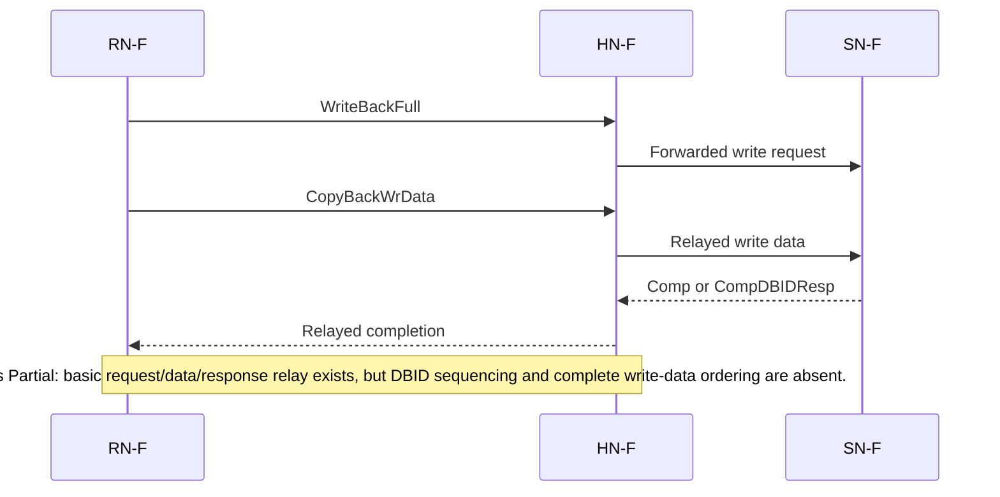
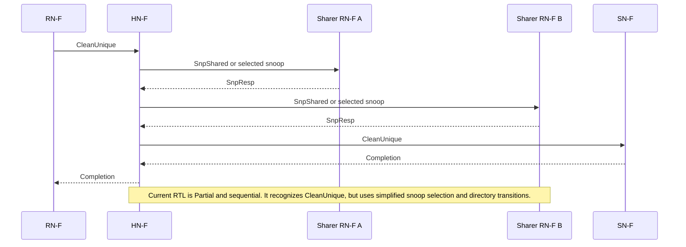
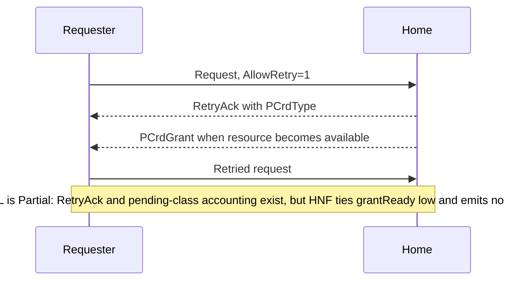
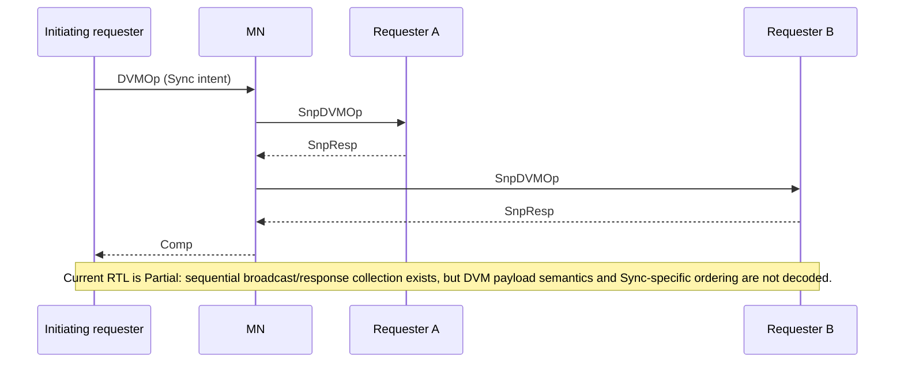

# Configurable AMBA CHI Interconnect Design Specification

## Document status

This Stage 8 document reconciles the original Stage 0 proposal with the RTL in
this repository. It describes a partial, reference implementation. It is not a
claim of AMBA CHI compliance, interoperability, or performance closure.

## 1. Scope, Issue H baseline, and feature status

### 1.1 Baseline and exclusions

The architectural reference is Arm IHI 0050H, AMBA CHI Architecture
Specification, Issue H, 17 September 2025:
<https://developer.arm.com/documentation/ihi0050/h/>. Section references in
this document identify relevant Issue H material without reproducing Arm
prose or tables.

The project addresses an on-chip CHI-like interconnect among RN-F, RN-D, RN-I,
SN-F, SN-I, HN-F, HN-I, and MN functions. CHI Chip-to-Chip (IHI 0098), CXS,
CCIX, die-to-die framing, C2C containers and link services, and
`PrefetchTgtHint` reconstruction are excluded. Ordinary on-chip
`PrefetchTgt` is represented only by an opcode. Issue H Device Assignment,
Coherent Device Assignment, GDI, PBHA semantics, Multi-request, Limited Data
Elision, and complete RME behavior are also outside the implemented scope.

The Issue H errata have not been assessed against this RTL. Therefore even an
item marked Implemented below means that the named project block exists and
performs the described local function; it does not mean Issue H compliance.

### 1.2 Status definitions

* **Implemented**: the function exists in synthesizable RTL over its stated,
  narrow project contract.
* **Partial**: useful logic exists, but protocol cases, integration, or
  end-to-end behavior are incomplete.
* **Not implemented**: no semantic implementation exists. An enum value or a
  packed field by itself does not constitute implementation.

### 1.3 Feature matrix

| Feature | Issue H reference | Status | Actual RTL boundary |
|---|---|---|---|
| REQ/RSP/SNP/DAT records and pack/unpack | B2.1-B2.2, B13.8-B13.10, C1 | Partial | Configurable packed records exist; field legality and all opcode-dependent overlays are not checked. |
| One node-facing interface type | B13 | Implemented | `if/chi_if.sv` is the only interface declaration and is a superset used by all five external node-class arrays. |
| Top-level interface count and replicated channels | B13.7 | Not implemented | `chi_cfg_check` requires `numIfPerNode == 1` and `replChannels == 1`; no top-level replication exists. |
| Standalone L-Credit manager and link TX/RX | B13.11, B14.2 | Implemented | `chi_lcrd_mgr`, `chi_link_tx`, and `chi_link_rx` account finite credits for a standalone channel. |
| Top-level L-Credit integration | B13.11, B14.2 | Not implemented | Top-level `*LCRDV` signals are mapped directly to internal ready/valid; standalone link blocks are not instantiated per interface/channel. |
| Standalone activation/deactivation FSM | B14.5-B14.6 | Implemented | STOP/ACTIVATE/RUN/DEACTIVATE FSMs and drain conditions exist. |
| Top-level activation and system-coherency integration | B14-B15 | Partial | Top-level acknowledgments are combinational echoes, `SACTIVE` follows reset, and `SYSCOACK` echoes `SYSCOREQ`; no link FSM is connected. |
| Interface parity/check signals | B9.3 | Partial | Standalone flit-byte parity generation/checking exists, but top-level rejects `parityEn=1` and drives its output check signals low. Control-check semantics are absent. |
| Four physically separated internal channels | B2.1, B13 | Implemented | REQ/RSP/SNP/DAT have separate ready/valid arrays, arbitration, and topology storage. |
| Crossbar | B1.2 topology freedom | Implemented | Per-output, per-channel QoS/age/round-robin arbitration. |
| Bidirectional ring | B1.2 topology freedom | Implemented | Shortest-direction routing, clockwise tie-break, directional registers, local/transit alternation, and ejection round-robin. |
| 2D mesh and deterministic XY routing | B1.2, B3 | Implemented | Per-channel routers, one output register per XP output, and placement-driven device ports. |
| NoC protocol L-Credits | B13.11 | Not implemented | Internal topology links use ready/valid; there are no per-hop CHI L-Credit counters. |
| Requester SAM, HN striping, and HNI SAM | B3.1-B3.3 | Implemented | Ordered region table, security rejection, XOR-fold hash, and runtime update ports exist. |
| Basic noncoherent HNI forwarding | B5 | Partial | One request at a time is retargeted and RSP/DAT are returned; full transaction sequencing and legality are absent. |
| Coherent read family | B4-B5 | Partial | HNF recognizes five coherent reads, may snoop, forwards to SN-F, and relays completion/data. Other enum values are not semantic support. |
| Write family | B5.3 | Partial | Ten basic writes are classified and relayed. DBID/data ordering, partial-write rules, cancellation, and all combined forms are incomplete. |
| CMO and combined write-CMO | B7 | Partial | Opcode classification and completion/persist tracking exist; architectural completion and all snoop/data effects are incomplete. |
| DCT | B2.5.1.3, B4.8, B5.1 | Partial | Eligibility and forwarding-snoop fields exist; fallback and complete forwarded-data/completion behavior are not demonstrated end-to-end. |
| DMT, including `ReadNoSnpSep` | B2.5.1.1-B2.5.1.2, B5.1 | Not implemented | `dmtEn` is only a configuration/check field; no DMT controller or direct-memory completion path exists. |
| DWT | B2.3.2, B13.10 | Not implemented | A request overlay bit and `dwtEn` exist, but no DWT sequencing exists. |
| Atomics | B2.3.3, B2.9.6, B4.2.5, B5.4 | Not implemented | Opcodes are enumerated but no atomic ALU, operand handling, serialization semantics, or return-data path exists. |
| DVM and MN | B2.3.7, B8 | Partial | MN serially unicasts `SnpDVMOp` to configured Requesters and waits for responses; full DVM message semantics and ordering are absent. |
| Sequential coherent snoops | B4.3-B4.4, B4.8 | Partial | HNF walks a precise sharer vector one RN-F at a time. Response content is mostly ignored. |
| RN cache states and transitions | B4.1, B4.6-B4.8 | Not implemented | State enums exist, but there is no RN cache controller or line-state RAM. |
| POS and same-line hazards | B1.5, B2.7, B4.11 | Partial | POS storage and hazard logic exist, but the HNF control FSM globally admits only one transaction, so configured POS concurrency is unused. |
| Inclusive precise snoop filter | B4.4, B4.11 | Partial | Set-associative sharer/owner RAM and replacement back-invalidation exist; state updates are simplified and not a complete CHI directory model. |
| RetryAck/PCrdGrant | B2.10 | Partial | RetryAck generation and four-class pending/age accounting exist. HNF ties grant ready low and never emits `PCrdGrant`. |
| Exclusives | B6 | Partial | Line/requester reservation monitors exist; request classification and all invalidation/success rules are simplified. |
| Stash and PrefetchTgt | B4.9, B4.2.6 | Not implemented | Fields/opcodes and parameter checks only. |
| Ordering and ReadReceipt | B2.7 | Partial | Ordered requests are globally serialized; `ReadReceipt` and complete endpoint ordering are not generated. |
| DataCheck and poison carriage | B9, B13.10 | Partial | Optional DAT bits pack/unpack; no end-to-end error semantics. |
| MTE tag semantics | B12, B13.10 | Not implemented | Tag fields are represented, but no allocation-tag storage, matching, or TagOp/TU behavior exists. |
| MEC semantics | B10.6, B13.10 | Not implemented | Optional 16-bit MECID carriage exists; no MEC access control, translation, or consistency checks exist. |
| MPAM | B11.4 | Partial | Optional fields are carried in REQ/SNP only; no resource partitioning or monitoring. |
| APB configuration | Project-defined | Implemented | A secure-write staged region editor and quiescent commit are provided, with limitations in Section 7. |
| CHI MMIO configuration | Project-defined | Partial | HNI recognizes a 4 KiB window and simple read/write offsets; security, validation, and quiescent commit are incomplete. |
| SVA | Relevant sections above | Partial | Bound local safety/stability properties and covers exist; no full protocol checker or proof closure. |

## 2. Architecture and hierarchy

### 2.1 Block diagram

```text
 RN-F/RN-D/RN-I arrays                 SN-F/SN-I arrays
       one chi_if each                    one chi_if each
              |                                  |
              +------ top-level flit adapters ---+
                              |
                    requester SAM/retarget
                              |
          +---------------- chi_noc_top ----------------+
          | CROSSBAR       RING           MESH_2D       |
          | separate REQ / RSP / SNP / DAT ready-valid |
          +--------------------+------------------------+
                               |
               +---------------+---------------+
               |               |               |
          chi_hnf_top      chi_hni_top      chi_mn_dvm
          coherent ref.    noncoherent/     DVM sequencer
                           CFG-MMIO ref.
               |               |
             SN-F             SN-I

 APB4 --> chi_cfg_slave --> shared SAM region-update broadcast
```

HN-F, HN-I, and MN are internal endpoints, not external `chi_if` ports.

### 2.2 RTL hierarchy

```text
chi_interconnect_top
├── chi_cfg_check
├── requester_sam[*] : chi_sam
│   └── chi_hn_hash
├── apb_cfg : chi_cfg_slave                     [CFG_APB]
├── hnf_nodes[*] : chi_hnf_top
│   ├── chi_pos
│   ├── chi_hazard
│   ├── chi_snoop_filter
│   ├── chi_snp_gen
│   ├── chi_retry
│   ├── chi_dct_ctrl
│   ├── chi_cmo
│   └── chi_excl_mon
├── hni_nodes[*] : chi_hni_top
│   └── chi_sam
├── mn_nodes[*] : chi_mn_dvm
└── chi_noc_top
    ├── chi_xbar ── chi_vc_arb[*]              [CROSSBAR]
    ├── chi_ring                                [RING]
    └── chi_mesh                                [MESH_2D]
        └── chi_mesh_xp[*]
            └── chi_router[REQ/RSP/SNP/DAT]
                ├── chi_route_compute[*]
                └── chi_vc_arb[*]
```

`chi_link_tx`, `chi_link_rx`, `chi_lcrd_mgr`, and `chi_link_fsm` form a
standalone link subsystem used by compile/SVA harnesses. They are not in the
`chi_interconnect_top` hierarchy.

## 3. Parameters and elaboration constraints

### 3.1 `chi_cfg_t`

All count fields are unsigned. “No explicit maximum” means the top checker has
no direct bound; array size, NodeID capacity, and tool resources still apply.

| Field | Default | Accepted by top `chi_cfg_check` | Effect |
|---|---:|---|---|
| `numRnf` | 4 | 0 or greater | External RN-F interfaces and HNF sharer width. |
| `numRnd` | 0 | 0 or greater | External RN-D interfaces. |
| `numRni` | 1 | 0 or greater | External RN-I interfaces. |
| `numSnf` | 2 | 0 or greater; required when `numHnf>0` | External SN-F interfaces. |
| `numSni` | 1 | 0 or greater; required when `numHni>0` | External SN-I interfaces. |
| `numHnf` | 4 | 0 or greater | Internal HN-F endpoints and hash targets. |
| `numHni` | 1 | 0 or greater | Internal HN-I endpoints. |
| `numMn` | 1 | 0 or greater | Internal MN endpoints. |
| `dataW` | 256 | 128, 256, or 512 | DAT data and derived BE/tag/TU/check widths. |
| `addrW` | 48 | 44 through 52 | REQ address and line/tag widths. |
| `nodeIdW` | 11 | 7 through 11 | Active NodeID bits. |
| `txnIdW` | 12 | 8 through 12 | TxnID/DBID-related widths. |
| `lpidW` | 5 | 1 through 5 | LPID overlay width. |
| `rsvdcW` | 0 | 0, 4, 8, 12, 16, 24, or 32 | REQ/DAT RSVDC width. |
| `ccidW` | 2 | 1 or 2 | DAT CCID width. |
| `groupIdW` | 8 | 1 through 8 | Group-ID overlays. |
| `numIfPerNode` | 1 | exactly 1 | Metadata only; multiple interfaces rejected. |
| `replChannels` | 1 | exactly 1 | Metadata/link lane input; top replication rejected. |
| `topology` | `MESH_2D` | `CROSSBAR`, `RING`, `MESH_2D` | Selects generated NoC. |
| `meshX`, `meshY` | 3, 3 | positive for mesh | Mesh coordinates and NodeID fields. |
| `numDevPortsPerXp` | 2 | positive for mesh | Local ports per XP and NodeID field. |
| `snpFilterEntries` | 1024 | positive, divisible by ways | Total HNF directory entries. |
| `snpFilterWays` | 4 | 1 through entries, exact divisor | Directory associativity. |
| `posEntries` | 32 | positive | POS array depth; current HNF still globally serial. |
| `lcrdDepth` | 8 | positive | Standalone link FIFO/credit depth. |
| `exclMonitors` | 32 | positive | Exclusive monitor entries. |
| `interleaveGranule` | 64 | power of two, at least 64 | HN hash stripe bytes. |
| `hnHashShift` | 6 | no top-level range check | XOR fold distance; shifts at or above `addrW` collapse the folded term to zero. |
| `dataCheckEn` | 1 | 0 or 1 | Adds `dataW/8` DAT DataCheck bits. |
| `poisonEn` | 1 | 0 or 1 | Adds `dataW/64` DAT poison bits. |
| `parityEn` | 0 | must be 0 at top | Standalone links support it; top rejects it. |
| `mpamEn` | 0 | 0 or 1 | Adds 15-bit MPAM to REQ/SNP. |
| `mteEn` | 0 | 0 or 1 | Controls DCT eligibility only; MTE semantics absent. |
| `mecEn` | 0 | 0 or 1 | Adds 16-bit MECID to REQ/SNP and changes DAT overlay width. |
| `dctEn` | 1 | if 1, RN-F and HN-F must exist | Enables limited DCT eligibility. |
| `dmtEn`, `dwtEn` | 1, 1 | if either 1, an HN and SN-F must exist | Checked metadata; semantic paths absent. |
| `atomicEn` | 1 | if 1, an HN must exist | Checked metadata; atomic semantics absent. |
| `dvmEn` | 1 | if 1, MN and any Requester must exist | Enables limited MN sequencer. |
| `stashEn` | 1 | if 1, RN-F and HN-F must exist | Checked metadata; stash absent. |
| `exclEn` | 1 | if 1, HN and monitor storage required | Enables exclusive monitor acceptance. |
| `cfgAccess` | `CFG_PARAM_ONLY` | enum value; CHI MMIO also requires HN-I | Selects no runtime writes, APB, or CHI MMIO. |

Derived default packed widths are REQ 148, RSP 73, SNP 105, and DAT 427 bits.
The formulas are `reqFlitWidth`, `rspFlitWidth`, `snpFlitWidth`, and
`datFlitWidth` in `chi_pkg`.

### 3.2 Top parameters and illegal combinations

| Parameter | Default/legal rule | Effect |
|---|---|---|
| `AGE_LIMIT` | 16; positive | QoS arbiter starvation promotion threshold. |
| `NUM_REGIONS` | 4; positive | SAM table depth and select width. |
| `NUM_NODES` | sum of all node counts; must equal that sum | Internal NoC endpoint count. |
| `NODE_IDS` | all-ones sentinel means derive default; effective IDs unique | Endpoint identities and routing targets. |
| `USE_DEFAULT_PLACEMENTS` | 1 | Select fixed 14-entry map; requires exactly 14 nodes. |
| `PLACEMENTS` | each valid, correct class/index, in range, collision-free | Custom mesh/local-port placement. |
| `CFG_MMIO_BASE` | top 4 KiB of address space | Must be 4 KiB aligned in CHI-MMIO mode. |
| `USE_DEFAULT_REGIONS` | 1 | Selects default map in Section 6. |
| `REGION_*` | arrays of `NUM_REGIONS` | Custom base, inclusive limit, target, attributes. |

For mesh, `meshX*meshY*numDevPortsPerXp >= NUM_NODES`,
`deviceIdWidth(CFG)>0`, placement coordinates/ports must fit, NodeIDs must
encode the placement routing fields, and no NodeID or placement may collide.
The checker does not explicitly prove that every ordinal fits the remaining
device-ID bits. Default placement is valid only for the default 14-node
population. HNF-to-SNF and HNI-to-SNI striping uses modulo, so the earlier
nonzero subordinate checks are essential.

## 4. The single `chi_if` node-facing interface

### 4.1 Superset rule

There is exactly one SystemVerilog interface declaration: `if/chi_if.sv`.
Every external RN-F, RN-D, RN-I, SN-F, and SN-I port is an array of this
superset interface. There are no class-specific or internal transport
interface declarations.

The interface has no modports, so directions below are integration rules, not
compiler-enforced directions. “Node” means the external endpoint; “IC” means
`chi_interconnect_top`. A logical count of zero still creates one sentinel
interface because portable SystemVerilog cannot declare a zero-length
interface array. That sentinel is inactive and must be tied off by integration.

### 4.2 Signal widths and drivers

Let `RW=reqFlitWidth(CFG)`, `SW=rspFlitWidth(CFG)`,
`NW=snpFlitWidth(CFG)`, `DW=datFlitWidth(CFG)`, and `PW(W)=ceil(W/8)`.

| Signal group | Width | Driver | Consumer | Applicability in current top |
|---|---:|---|---|---|
| `CLK`, `RESETn` | 1 each | IC | Node | All classes; mirrors `clk`, synchronous active-low `resetn`. |
| `TXLINKACTIVEREQ`, `SYSCOREQ` | 1 each | Node | IC | All classes; request is echoed, not FSM-controlled. |
| `TXLINKACTIVEACK`, `RXLINKACTIVEREQ`, `TXSACTIVE`, `RXSACTIVE`, `SYSCOACK` | 1 each | IC | Node | All classes; simplified top behavior. |
| `RXLINKACTIVEACK` | 1 | Node | IC | Declared for all; top does not use it. |
| `TXREQFLITPEND`, `TXREQFLITV`, `TXREQFLIT[RW-1:0]` | 1, 1, RW | Node | IC | RN-F/RN-D/RN-I. `PEND` is declared but top uses only `V` and flit. |
| `TXREQLCRDV` | 1 | IC | Node | Requesters; directly reflects internal ready, not a returned L-Credit pulse. |
| `RXREQFLITPEND`, `RXREQFLITV`, `RXREQFLIT[RW-1:0]` | 1, 1, RW | IC | Node | SN-F/SN-I. |
| `RXREQLCRDV` | 1 | Node | IC | SN-F/SN-I; used as internal ready. |
| `TXRSPFLITPEND`, `TXRSPFLITV`, `TXRSPFLIT[SW-1:0]` | 1, 1, SW | Node | IC | All five classes can drive in the superset; top consumes RN and SN RSP `V`/flit. |
| `TXRSPLCRDV` | 1 | IC | Node | All classes; direct internal-ready indication. |
| `RXRSPFLITPEND`, `RXRSPFLITV`, `RXRSPFLIT[SW-1:0]` | 1, 1, SW | IC | Node | RN-F/RN-D/RN-I; tied inactive for SN-F/SN-I. |
| `RXRSPLCRDV` | 1 | Node | IC | Requesters; used as ready. SN value is unused. |
| `TXSNPFLITPEND`, `TXSNPFLITV`, `TXSNPFLIT[NW-1:0]` | 1, 1, NW | Node | IC | Unused for every external class; top never accepts external SNP. |
| `TXSNPLCRDV` | 1 | IC | Node | Tied low for every class. |
| `RXSNPFLITPEND`, `RXSNPFLITV`, `RXSNPFLIT[NW-1:0]` | 1, 1, NW | IC | Node | RN-F/RN-D/RN-I in current wiring; tied inactive for SN-F/SN-I. |
| `RXSNPLCRDV` | 1 | Node | IC | Requesters; used as ready. |
| `TXDATFLITPEND`, `TXDATFLITV`, `TXDATFLIT[DW-1:0]` | 1, 1, DW | Node | IC | All five classes; top consumes `V`/flit. |
| `TXDATLCRDV` | 1 | IC | Node | All classes; direct internal-ready indication. |
| `RXDATFLITPEND`, `RXDATFLITV`, `RXDATFLIT[DW-1:0]` | 1, 1, DW | IC | Node | All five classes. |
| `RXDATLCRDV` | 1 | Node | IC | All five classes; used as ready. |
| scalar `*CHK` beside control/valid/credit signals | 1 each | Same side as checked base signal | Opposite side | Declared for all; node-driven checks are ignored and IC-driven checks are zero. |
| `TXREQFLITCHK`, `RXREQFLITCHK` | `PW(RW)` | Same side as flit | Opposite side | Declared; not generated/checked at top. |
| `TXRSPFLITCHK`, `RXRSPFLITCHK` | `PW(SW)` | Same side as flit | Opposite side | Declared; not generated/checked at top. |
| `TXSNPFLITCHK`, `RXSNPFLITCHK` | `PW(NW)` | Same side as flit | Opposite side | Declared; not generated/checked at top. |
| `TXDATFLITCHK`, `RXDATFLITCHK` | `PW(DW)` | Same side as flit | Opposite side | Declared; not generated/checked at top. |

Unused node outputs must be tied to zero; unused IC outputs are already driven
inactive by the top. Integrators must not infer legal channel capability from
the presence of a signal in this superset.

## 5. Topologies, routing, arbitration, and progress

### 5.1 Common transport

`chi_noc_flit_t` carries channel, QoS, target NodeID, and an opaque maximum DAT
payload. REQ, RSP, SNP, and DAT are separate ready/valid fabrics. They do not
share buffers or arbiters. Backpressure requires valid and payload stability.
These are internal ready/valid channels, not CHI link-credit channels.

### 5.2 Crossbar

```text
inputs[*] -- target compare --> arbiter per {channel, output} --> outputs[*]
```

Each output selects the highest QoS request; equal QoS starts at a rotating
index. Once age reaches `AGE_LIMIT`, aged requests exclude non-aged requests.
A stalled grant locks until accepted. An uncongested output can accept one
flit per channel per cycle. Unknown target IDs remain backpressured.

### 5.3 Bidirectional ring

```text
       [0] <====> [1]
        ^          |
        |          v
       [3] <====> [2]
```

Distance is computed from endpoint array order. Shorter direction wins and an
exact tie goes clockwise. Each node/direction/channel has one registered slot.
When local injection and transit contend for an empty slot, a preference bit
alternates after the winner, preventing permanent local or transit starvation
under continued service. Clockwise, counter-clockwise, and local ejection
requests use a three-way rotating priority. There is no QoS or age threshold
in the ring.

For planning, use a conservative sustained rate of **0.5 flit/cycle per
directional link per channel** under injection/transit contention. This is a
budgeting bound, not an asserted guarantee; uncongested trains can do better,
while blocked ejection can do worse.

### 5.4 Mesh, placement, and NodeID

Routing is deterministic XY: east/west to destination X, then north/south to
destination Y, then local device port. Coordinates start at southwest `(0,0)`.

```text
                         north
        x=0                    x=1                    x=2
y=2  [p0 HNF2, p1 --]       [p0 --,   p1 --]       [p0 HNF3, p1 --]
y=1  [p0 SNI0, p1 RNF2]----[p0 MN0,  p1 HNI0]----[p0 SNF1, p1 RNF3]
y=0  [p0 HNF0, p1 RNF0]----[p0 SNF0, p1 RNF1]----[p0 HNF1, p1 RNI0]
                         south
```

The project-defined encoding is:

```text
NodeID = {meshY, meshX, devicePort, deviceId}
field width = max(1, ceil(log2(cardinality))) for Y, X, and port
deviceId width = NODEID_W - Y width - X width - port width
```

For defaults: `[10:9]=Y`, `[8:7]=X`, `[6]=port`, `[5:0]=ordinal`.
Ordinals run RN-F, RN-D, RN-I, SN-F, SN-I, HN-F, HN-I, MN. The default HNF
NodeIDs are HNF0 `11'h008`, HNF1 `11'h109`, HNF2 `11'h40a`, and HNF3
`11'h50b`. The default hash array order follows ordinal order; physical corner
placement provides the spatial distribution.

With no contention, each `chi_router` contributes one registered XP output
stage and mesh wires between XPs are combinational. For source `(sx,sy)` and
destination `(dx,dy)`:

```text
hops = abs(dx-sx) + abs(dy-sy)
planning latency ≈ (hops + 1) XP cycles + endpoint/adaptor cycles
```

Stalls add arbitration and destination-backpressure cycles.

### 5.5 Snoop distribution, deadlock, and livelock

HN-F snoops are sequential unicasts in ascending sharer index. Only one snoop
is outstanding from the generator; latency therefore sums the round trips of
all sharers. HN-F `i` is statically striped to SN-F `i % numSnf`; HNI uses the
same modulo rule for SN-I.

Separate channel fabrics prevent one protocol channel from consuming another
channel's transport buffer. Mesh XY routing is dimension ordered. These choices
reduce routing-dependency cycles, but the repository has no complete
protocol-level deadlock proof. Ring finite slots plus blocked ejection can
backpressure a direction globally. Crossbar/mesh age arbitration and ring
rotating preferences address local starvation; there is no end-to-end
livelock watchdog or bounded-completion proof.

## 6. System Address Map

### 6.1 Lookup and default regions

Regions use inclusive `[base, limit]` bounds and ascending-index first-match
priority. Attributes are `[3:2]=kind`, `[1]=secureOnly`, `[0]=valid`.
A secure-only match by a non-secure request returns `unmappedError`; lookup
does not fall through to an overlapping lower-priority region.

With `NUM_REGIONS=4` and `USE_DEFAULT_REGIONS=1`:

| Index | Base | Inclusive limit | Kind/target | Valid |
|---:|---|---|---|---:|
| 0 | `0` | `2^(ADDR_W-1)-1` | HNF hash | 1 |
| 1 | `2^(ADDR_W-1)` | `CFG_MMIO_BASE-1` | HNI0 when present | 1 |
| 2 | `CFG_MMIO_BASE` | `2^ADDR_W-1` | MMIO, HNI0 when present | 1 |
| 3 | `0` | `0` | zero target | 0 |

Default `CFG_MMIO_BASE` is `2^ADDR_W-4096`.

### 6.2 HN hash and worked example

```text
granuleNumber = address >> log2(INTERLEAVE_GRANULE)
hashValue     = granuleNumber xor (granuleNumber >> HN_HASH_SHIFT)
hnfIndex      = hashValue mod NUM_HNF
target        = HN_NODE_IDS[hnfIndex]
```

At defaults, address `0x0000_0000_10c0` gives granule number `0x43`,
folded value `0x42` (`0x43 xor 0x1`), index `2` (`0x42 mod 4`), and target
HNF2 (`11'h40a`).

### 6.3 Retargeting

APB or CHI-MMIO updates replace one active region atomically at the SAM clock
edge. The update is broadcast to requester SAMs and HNI staging/SAM state.
APB requires the top's `trafficQuiescent`; that predicate checks external NoC
ingress valids and HNF/HNI/MN idle, but not every internal topology slot.
CHI-MMIO commit has no quiescence check. Software must avoid overlapping
active traffic and must stage base, limit, target, and attributes before
commit. RTL does not validate base <= limit or target existence on runtime
updates.

## 7. Configuration access

CHI defines no register map for this project. The access mechanism, offsets,
security policy, and commit protocol below are **IMPLEMENTATION DEFINED**.

### 7.1 APB4 map

APB is on `clk`; `PREADY` is always 1. Addresses are 12-bit and word aligned.
Writes merge bytes selected by `PSTRB`. Reads are unrestricted. A write with
`PPROT[1]=1` is rejected as non-secure. Unsupported/misaligned accesses,
out-of-range SELECT writes, and non-quiescent COMMIT writes return `PSLVERR`.

| Offset | Name | Access | Reset/read value | Write effect |
|---:|---|---|---|---|
| `0x000` | SELECT | RW | 0 | Select region; reject value >= `NUM_REGIONS`. |
| `0x004` | BASE_LO | RW | `REGION_BASE[n][31:0]` | Stage low address bytes. |
| `0x008` | BASE_HI | RW | upper configured address bits | Stage bits `ADDR_W-1:32`. |
| `0x00c` | LIMIT_LO | RW | `REGION_LIMIT[n][31:0]` | Stage low limit bytes. |
| `0x010` | LIMIT_HI | RW | upper configured limit bits | Stage bits `ADDR_W-1:32`. |
| `0x014` | TARGET | RW | `REGION_TARGET[n]` | Stage low `NODEID_W` bits. |
| `0x018` | ATTRIBUTES | RW | `REGION_ATTRIBUTES[n]` | Stage low four bits. |
| `0x01c` | COMMIT | W, reads zero | 0 | If byte strobe 0 is set and traffic is quiescent, pulse one region update. |

Required software order is SELECT, stage all changed fields, stop initiators,
observe system-specific quiescence, then COMMIT. A COMMIT with `PSTRB[0]=0`
does nothing and does not error.

### 7.2 CHI MMIO map and limitations

The HNI recognizes any address in the 4 KiB window at `CFG_MMIO_BASE`.

| Low-byte offset | Read/write object |
|---:|---|
| `0x00` | selected region |
| `0x08` | full staged base |
| `0x10` | full staged inclusive limit |
| `0x18` | staged target |
| `0x20` | staged attributes |
| `0x28` | write commits; reads fall through to selected-region value |

Reads accepted by `isRead` return one `DAT_COMP_DATA`; writes consume the next
DAT flit and return `RSP_COMP`. The path does not check DAT opcode, byte
enables, security/PAS, privilege, base/limit validity, target validity, or
quiescence. Unsupported offsets silently read SELECT or ignore writes and
still complete successfully. An invalid SELECT payload is silently ignored.
Only one HNI transaction is active at a time. Consequently this mechanism is
a reference control path, not a hardened management interface.

## 8. Architectural flows and current support

The following Mermaid diagrams show the **architecturally intended flow**.
Notes in each diagram state the current RTL support and must be read as part of
the diagram.

### 8.1 ReadShared with DCT

```mermaid
sequenceDiagram
    participant R as Requesting RN-F
    participant H as HN-F
    participant O as Owning RN-F
    R->>H: ReadShared
    H->>O: SnpSharedFwd
    O-->>R: CompData (forwarded data)
    O-->>H: SnpRespFwded
    H-->>R: Completion as required
    Note over R,H: Intended DCT flow. RTL is Partial: eligibility and forwarding snoop exist; complete dual-destination completion/data rules are not established.
```

### 8.2 ReadUnique with DMT

```mermaid
sequenceDiagram
    participant R as RN-F
    participant H as HN-F
    participant S as SN-F
    R->>H: ReadUnique
    H->>S: Read request with direct-memory intent
    S-->>R: CompData direct to requester
    S-->>H: Completion/response needed by Home
    H-->>R: Home completion as required
    Note over R,S: Intended DMT flow only. Current RTL: Not implemented; dmtEn and opcode/overlay representation do not create this path.
```

### 8.3 WriteBackFull



### 8.4 CleanUnique with snoops



### 8.5 AtomicLoad

```mermaid
sequenceDiagram
    participant R as Requester
    participant H as Home
    participant S as Subordinate
    R->>H: AtomicLoad opcode plus operand data
    H->>S: Serialized atomic operation
    S-->>H: Original value and completion
    H-->>R: Atomic return data/completion
    Note over R,S: Architectural intent only. Current RTL: Not implemented; atomic opcode enums are not execution logic.
```

### 8.6 Retry



### 8.7 DVM Sync



## 9. HN-F serialization, directory, hazards, and retry

`chi_pos` contains `posEntries` records with line, requester, TxnID, opcode,
and completion flags. `chi_hazard` blocks same-line overlap, blocks an ordered
request while any POS entry is active, and blocks all new requests while an
ordered entry is active. This is more conservative than a line-only POS.

The controlling `chi_hnf_top` FSM is the stronger limitation: it accepts a
normal request only in `HNF_IDLE`, stores one `activeReq`, and does not return
to idle until completion or CompAck. Therefore **all normal HNF transactions
are globally serialized**, regardless of `posEntries`; the multi-entry POS
does not create concurrency.

The snoop filter is set-associative, tracks precise RN-F sharers and one owner,
uses rotating replacement ways, and requests sequential back-invalidation
before replacing a valid full set. HNF updates are simplified: writes
invalidate, unique reads select the requester as sole sharer/owner, and other
recognized coherent reads OR in the requester. It does not model the complete
Issue H state machine.

When resources are unavailable and `AllowRetry` is set, HNF returns RetryAck.
Four classes use `pCrdType[1:0]`; pending classes age and oldest age wins.
Credit return/cancel can decrement counts. Since `grantReady` is tied low,
grants never retire or reach the NoC. Requests with `AllowRetry=0` remain
backpressured. There is no bounded retry guarantee.

## 10. RN-F boundary cache-state model

These tables are the **required architectural model for an eventual RN-F cache
controller**, not behavior implemented by this repository. `chi_pkg` defines
I, SC, UC, UD, SD, and UDP encodings, but no RN line-state storage or
transition controller exists.

### 10.1 Request-driven target states

| RN starting state | Operation | Intended successful target | Required external effects |
|---|---|---|---|
| I | ReadShared/ReadClean | SC, or permitted dirty shared state from response | Install returned line and honor response state. |
| I/SC | ReadUnique/MakeUnique | UC or UD according to returned dirtiness | Invalidate other sharers before exclusive ownership. |
| SC | CleanUnique | UC | Complete snoops/cleaning before uniqueness. |
| UC | Local write | UD | Mark dirty locally. |
| UD/SD | WriteBackFull | I or clean retained state according to transaction/result | Transfer full dirty data and wait for required completion. |
| Any valid | Evict/MakeInvalid | I | Satisfy writeback/invalidating obligations first. |
| Any | AtomicLoad/Store/Swap/Compare | State dictated by atomic response | Serialize operands, data update, and returned value. |

### 10.2 Snoop-driven transitions

| Starting state | Snoop class | Intended result | Data obligation |
|---|---|---|---|
| I | Any | I | Respond no copy; no data. |
| SC | Shared/Clean | SC | Usually no dirty data. |
| SC | Unique/MakeInvalid | I | Invalidate; respond. |
| UC | Shared | SC | Downgrade ownership. |
| UC | Unique/MakeInvalid | I | Invalidate. |
| UD | Shared | SD or SC as response requires | Supply dirty data or transfer responsibility. |
| UD/SD/UDP | Unique/MakeInvalid | I | Supply dirty/partial data as required, then invalidate. |
| Valid owner | Forward snoop | Result dictated by forward response | Send data to forward target and response to Home. |

Partial/empty line and UDP handling, MTE allocation tags, poison/DataCheck
propagation, and all legal response-state combinations remain unimplemented.

## 11. Clocking, reset, CDC, and performance

All RTL uses one `clk`. APB `PCLK` is connected to it and every external
`chi_if.CLK` mirrors it. There are no asynchronous clock domains, synchronizers,
or CDC FIFOs. Multi-clock integration requires external adapters and CDC
analysis.

`resetn`/`PRESETn` is active low but sampled synchronously because sequential
blocks use `always_ff @(posedge clk)` and test `if (!resetn)`; there is no
asynchronous reset edge. Integration must assert reset long enough to be
sampled and must provide synchronous deassertion.

Reference throughput limits:

* Crossbar: at most one accepted flit per output/channel/cycle.
* Ring: one slot per node/direction/channel; use the conservative 0.5
  flit/cycle planning rate in Section 5.3 under transit/injection contention.
* Mesh: one registered slot per XP output/channel; no-contention network
  latency is approximately `hops+1` XP cycles, with ready/valid stalls.
* HNF, HNI, and MN each process only one architectural transaction at a time;
  sequential snoops/DVMs add one full response round trip per target.

No timing constraints, synthesis reports, PPA results, latency tests, or
performance guarantees are supplied.

## 12. Verification, source manifest, and lint

### 12.1 Exact bound SVA inventory

| File | Assertions | Covers |
|---|---|---|
| `chi_link_sva.sv` | `NO_SEND_WITHOUT_RUN_OR_CREDIT`, `NO_CREDIT_OVERFLOW`, `NO_CREDIT_UNDERFLOW`, `STOP_TRANSITION_VALID`, `ACTIVATE_TRANSITION_VALID`, `RUN_TRANSITION_VALID`, `DEACTIVATE_TRANSITION_VALID`, `DEACTIVATION_CREDITS_DRAINED` | `LINK_ACTIVATION`, `LINK_DEACTIVATION` |
| `chi_link_rx_sva.sv` | `BUFFER_COUNT_IN_RANGE`, `NO_BUFFER_OVERFLOW`, `NO_RECEIVE_WITHOUT_RUN`, `STOP_TRANSITION_VALID`, `ACTIVATE_TRANSITION_VALID`, `RUN_TRANSITION_VALID`, `DEACTIVATE_TRANSITION_VALID`, `DEACTIVATION_BUFFER_DRAINED`, `PARITY_ERROR_OBSERVED`, `PARITY_ERROR_ONLY_WHEN_ENABLED` | `LINK_ACTIVATION`, `LINK_DEACTIVATION` |
| `chi_proto_sva.sv` | `REQ_INPUT_STABLE_UNDER_BACKPRESSURE`, `RSP_INPUT_STABLE_UNDER_BACKPRESSURE`, `DAT_INPUT_STABLE_UNDER_BACKPRESSURE`, `REQ_STABLE_UNDER_BACKPRESSURE`, `RSP_STABLE_UNDER_BACKPRESSURE`, `SNP_STABLE_UNDER_BACKPRESSURE`, `DAT_STABLE_UNDER_BACKPRESSURE`, `ACTIVE_RESPONSE_ID_CONSISTENT`, `RETRY_RESPONSE_ID_CONSISTENT`, `ONE_COMPLETION_PATH` | `RETRY_ACK_THEN_PCRD_GRANT_CLASS`, `DCT_SNOOP_FORWARD_PATH`, `DIRECTORY_BACK_INVALIDATION`, `EXCLUSIVE_SUCCESS`, `BASIC_READ_FLOW`, `BASIC_WRITE_FLOW` |
| `chi_mn_sva.sv` | `REQ_INPUT_STABLE_UNDER_BACKPRESSURE`, `RSP_INPUT_STABLE_UNDER_BACKPRESSURE`, `SNP_STABLE_UNDER_BACKPRESSURE`, `RSP_STABLE_UNDER_BACKPRESSURE`, `DVM_RESPONSE_ID_CONSISTENT` | `DVM_COMPLETION` |
| `chi_ordering_sva.sv` | pairwise `NO_DUPLICATE_ACTIVE_LINE`, per-entry `ALLOCATION_LINE_NOT_ACTIVE` | none |
| `chi_hnf_ordering_sva.sv` | `ORDERED_REQUEST_STARTS_QUIESCENT`, `ACTIVE_ORDERED_REQUEST_SERIALIZES` | none |

These are local assertions. They do not check complete opcode legality,
credit conservation at top interfaces, cache-state correctness, all response
dependencies, or end-to-end forward progress.

### 12.2 Functional coverage outline

A complete environment should cross topology, channel, source/destination,
QoS, backpressure length, and route length; cover all supported request,
response, snoop, and data opcodes; exercise SAM first-match/security/update
cases; hit every HNF state, snoop-filter hit/miss/replacement, hazard reason,
retry class, exclusive success/failure, DCT eligibility/fallback, DVM target
count, APB error, and CHI-MMIO offset. Negative bins should include unknown
NodeIDs, illegal configuration, malformed completion IDs, parity faults in
standalone links, and unsupported semantic features.

### 12.3 UVM structure

```text
chi_env
├── rn_agent[*] / sn_agent[*]      (active node-facing chi_if agents)
├── apb_agent                      (active only for CFG_APB)
├── protocol_scoreboard            (TxnID/DBID/data/completion dependencies)
├── directory_reference_model      (architectural RN states and sharers)
├── sam_reference_model            (regions, security, hash, commit)
├── topology_route_scoreboard      (NodeID, channel preservation, ordering)
├── virtual_sequencer              (reads, writes, snoops, DVM, retry)
└── coverage_collector
```

Agents must apply node-class channel rules from Section 4 rather than drive
every signal in the superset.

### 12.4 Formal-friendly properties

Recommended proof targets are: ready/valid stability; no duplication/loss in
each topology; destination and channel preservation; one-hot grants; bounded
age service under permanently ready outputs; XY monotonicity; ring slot
conservation; standalone credit conservation; SAM first-match determinism;
commit atomicity; no duplicate HNF line ownership; sequential snoop target
uniqueness; completion IDs matching the accepted request; and reset returning
all valid state to empty. Liveness assumptions must state eventual downstream
ready and eventual legal response.

### 12.5 Source manifest

`filelist.f` is the authoritative compile order:

```text
pkg/chi_cfg_pkg.sv
pkg/chi_pkg.sv
if/chi_if.sv
link/chi_lcrd_mgr.sv
link/chi_link_fsm.sv
link/chi_link_tx.sv
link/chi_link_rx.sv
noc/chi_vc_arb.sv
noc/chi_xbar.sv
noc/chi_ring.sv
noc/chi_route_compute.sv
noc/chi_router.sv
noc/chi_mesh_xp.sv
noc/chi_mesh.sv
noc/chi_noc_top.sv
sam/chi_hn_hash.sv
sam/chi_sam.sv
hni/chi_cfg_slave.sv
hni/chi_hni_top.sv
mn/chi_mn_dvm.sv
hnf/chi_pos.sv
hnf/chi_hazard.sv
hnf/chi_snoop_filter.sv
hnf/chi_snp_gen.sv
hnf/chi_retry.sv
hnf/chi_dct_ctrl.sv
hnf/chi_cmo.sv
hnf/chi_excl_mon.sv
hnf/chi_hnf_top.sv
top/chi_interconnect_top.sv
top/chi_link_compile.sv
top/chi_hnf_compile.sv
sva/chi_link_sva.sv
sva/chi_link_rx_sva.sv
sva/chi_proto_sva.sv
sva/chi_mn_sva.sv
sva/chi_ordering_sva.sv
sva/chi_hnf_ordering_sva.sv
top/chi_sva_compile.sv
```

`top/chi_stage1_compile.sv`, `top/chi_sam_compile.sv`,
`top/chi_xbar_compile.sv`, `top/chi_ring_compile.sv`, and
`top/chi_mesh_compile.sv` are supplemental elaboration harnesses and are not
entries in `filelist.f`. They are not product hierarchy.

### 12.6 Passing lint commands

The following commands pass with the repository's Verilator setup:

```sh
verilator --lint-only --sv -Wall -Wno-fatal \
  -Wno-UNUSEDSIGNAL -Wno-UNUSEDPARAM -Wno-UNDRIVEN \
  -f filelist.f --top-module chi_interconnect_top

verilator --lint-only --sv -Wall -Wno-fatal \
  -Wno-UNUSEDSIGNAL -Wno-UNUSEDPARAM -Wno-UNDRIVEN \
  -f filelist.f --top-module chi_sva_compile
```

`UNUSEDSIGNAL` and `UNUSEDPARAM` are suppressed because superset protocol
records, optional ports, and compile harnesses intentionally expose fields not
consumed in every generated configuration. `UNDRIVEN` is suppressed because
the lint tops do not instantiate external node drivers for `chi_if`.
`Wno-fatal` allows other warnings to be reported without converting them to
failure. Supplemental harnesses can be checked by appending the harness file
and selecting it as top, for example:

```sh
verilator --lint-only --sv -Wall -Wno-fatal \
  -Wno-UNUSEDSIGNAL -Wno-UNUSEDPARAM -Wno-UNDRIVEN \
  -f filelist.f top/chi_ring_compile.sv --top-module chi_ring_compile
```

Icarus Verilog is not part of the verified command set in this environment.

## 13. Open issues, known limitations, and decisions

### 13.1 Known limitations

1. Top-level CHI activation, L-Credits, parity/checks, and system-coherency
   handshakes are placeholders rather than standalone-link integration.
2. Exactly one interface and one channel replica are accepted.
3. HNF, HNI, and MN globally serialize transactions; configured POS depth does
   not provide HNF parallelism.
4. DMT, DWT, atomics, stash, prefetch semantics, RN cache-state transitions,
   MTE semantics, and MEC policy are not implemented.
5. DCT, CMO, DVM, retry, exclusives, ordering, coherent state/directory
   behavior, and noncoherent forwarding are partial reference paths.
6. Runtime SAM writes lack complete validation; CHI-MMIO lacks security and
   quiescent commit; APB quiescence does not inspect all topology storage.
7. Unknown NoC destinations backpressure indefinitely and have no error sink.
8. No full protocol testbench, formal proof closure, interoperability evidence,
   CDC signoff, synthesis signoff, or performance characterization is present.

### 13.2 Implementation-defined decision log

| Decision | Current choice | Consequence |
|---|---|---|
| Node-facing interfaces | One superset `chi_if` | Applicability is documented/tied off; direction is not modport-enforced. |
| Zero logical node count | Physical one-element sentinel array | Integrator ties inactive sentinel outputs low. |
| Internal flow control | Ready/valid | No claim of per-hop CHI L-Credits. |
| HN selection | XOR-folded granule modulo `NUM_HNF` | Supports non-power-of-two HNF counts. |
| SAM overlap | Lowest region index wins | Security rejection at first match does not fall through. |
| NodeID | `{Y,X,port,ordinal}` | Placement and route fields must agree. |
| Mesh route | Deterministic XY | Simple dependency ordering; no adaptive balancing. |
| Ring tie | Clockwise | Deterministic equal-distance selection. |
| Snoop/DVM fanout | Sequential unicast | Minimal replication state, additive target latency. |
| HNF-to-subordinate mapping | Index modulo subordinate count | Static striping, not address-based subordinate balancing. |
| APB security | Writes require `PPROT[1]==0` | Reads remain unrestricted. |
| Reconfiguration | Staged fields plus explicit commit | Software owns ordering; CHI-MMIO is less protected than APB. |
| Reset | Synchronous active-low | No asynchronous reset behavior or CDC support. |
